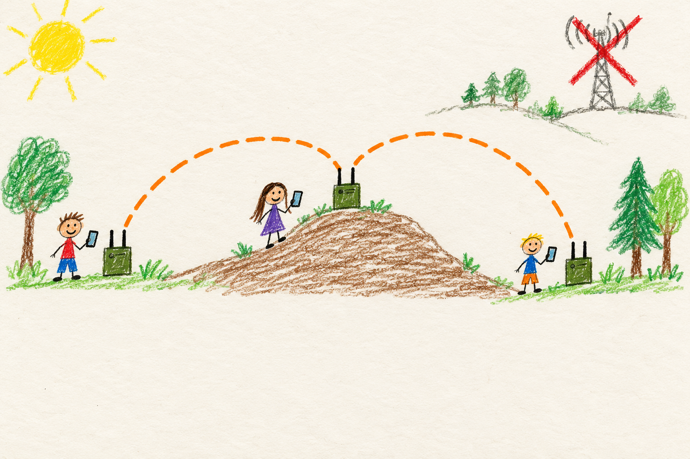

# What this does

## Marine

### Radios that pass notes

Phones need a cell tower or Wi-Fi to talk. Out in the woods there might not be any.

A MANET radio is a little box. You carry one. Your friends carry one too. The boxes talk to each other. No tower needed.

Is your friend too far away? The box in the middle passes your message along, like passing a note down the row in class.

Your phone talks to your box. Then you can share maps, talk with a headset, and send pictures to your friends.

- **More boxes, more reach.** Every box helps pass messages along.
- **Boxes fix themselves.** If one box goes away, the others find another way.
- **No internet needed.** If one box has internet, it can share it.

Want one? See [what is in the box](hardware.md).

## User

### What MANET does

MANET turns small single-board computers into mesh radios. A mesh is a
network where every radio connects to the radios near it and passes traffic
along for the others. There is no cell tower, central router or internet
connection in the middle. Turn on a few radios with the same mesh settings
and they find each other and build the network themselves.

Your phone, laptop, or other end user device (EUD) connects to its own radio
by Wi-Fi or an Ethernet cable. From there, it can reach every other device on
the mesh, even one several radios away. Each radio forwards traffic for its
neighbors, so a message can hop from radio to radio until it arrives.

### Why use a mesh

- **No infrastructure.** It works where there is no cell service, where the
  cell network is down, or where you do not want to depend on it.
- **No setup on the day.** Radios choose their own addresses and channels
  and agree on them together. Nobody has to configure a network on site.
- **It repairs itself.** When a radio moves out of range or turns off, the
  others route around it. When groups that were separated meet again, they
  join back into one mesh.
- **Normal devices.** Phones and laptops connect like they would to any
  Wi-Fi network or Ethernet port, and use ordinary apps.

### What you can do with it

- **Share locations and maps** with [ATAK](location.md), a free map and team
  awareness app for Android.
- **Talk with push to talk** using a headset and PTT button plugged into
  the radio. See [voice](voice.md).
- **Share an internet connection** from any radio that has one. See
  [internet](internet.md).
- **Use shared services** such as video streams, a Mumble voice server and
  file sync. See [services](services.md).
- **See the whole mesh** on the radio's [dashboard](dashboard.md), and
  [measure](measurements.md) how well each link is working.

### How it works

Each radio has two kinds of radio links to other radios:

| Link | What it is good at |
|---|---|
| Wi-Fi (2.4 GHz and 5 GHz) | High speed over shorter distances. |
| HaLow (900 MHz) | Longer reach and getting through trees and walls, at lower speed. |

The radios use whichever links are working and pick the best path for each
message. Wi-Fi and HaLow can both connect the same group of radios, so if one
kind of link fails, the other can keep the group together. Real range and
speed depend on the antennas, height, terrain and what is in the way. See
[meet the mesh](overview.md) for how the radios share addresses, channels
and services.

### Who would use it

MANET is for groups that need to stay connected to each other where phones
alone will not do it. Examples include search and rescue teams, event staff
spread over a large site, people working on farms, ranches or job sites with
poor coverage, emergency and disaster response, and groups hiking, hunting
or camping together. It is also an open project for people who want to build
and improve their own radios.

### What it is not

A mesh connects the people on it to each other. It does not replace the cell
network for calling ordinary phone numbers or browsing the web, unless one
radio shares an internet connection. Each radio needs to be within range of
at least one other radio, so a mesh spread too thin breaks into separate
groups until radios come back into range.

### The hardware

The current radios are built around a Raspberry Pi Compute Module 4 (CM4)
on a Waveshare CM4 IO board, with a MediaTek MT7916 Wi-Fi card and a Morse
Micro HaLow card or USB dongle. That is the hardware the project develops
and tests on. The [hardware page](hardware.md) lists every supported board
and what each part does.

The goal is a single purpose-built radio. The **Raven** carrier board from
[BuildsByShane](https://buildsbyshane.com) holds the CM4, the Wi-Fi card and
the HaLow card on one board, with stronger power delivery than the boards in
use now. An enclosure for the Raven radio is being developed.

### Get started

1. [Choose the hardware](hardware.md) for your radio.
2. [Flash a radio](flash.md) with the settings for your mesh.
3. [Complete the first boot](first-boot.md).
4. [Connect your device](connect.md).

## Developer

### The technology in a MANET radio

MANET is built from existing open standards and open-source projects. This
page names each one, says what MANET uses it for, and links to an outside
reference. [Meet the mesh](overview.md#developer-runtime-architecture)
explains how they fit together, and the topic pages explain each mechanism.

### Mesh networking

| Technology | Used for | Reference |
|---|---|---|
| Mobile ad hoc network (MANET) | The general idea: a self-configuring network of mobile nodes with no fixed infrastructure. | [Wikipedia](https://en.wikipedia.org/wiki/Mobile_ad_hoc_network) |
| batman-adv, BATMAN V | Layer 2 mesh routing in the Linux kernel. Every radio link joins one virtual interface, `bat0`, and BATMAN V picks paths by measured throughput. | [open-mesh.org](https://www.open-mesh.org/projects/batman-adv/wiki), [BATMAN V](https://www.open-mesh.org/projects/batman-adv/wiki/BATMAN_V), [kernel docs](https://docs.kernel.org/networking/batman-adv.html) |
| Alfred | Distributes identity, telemetry and authenticated control records between radios over the mesh. | [open-mesh.org](https://www.open-mesh.org/projects/alfred/wiki) |
| IEEE 802.11s | The Wi-Fi mesh link layer under BATMAN, on both conventional Wi-Fi and HaLow. Mesh peers authenticate with SAE using the shared mesh password. | [Wikipedia](https://en.wikipedia.org/wiki/IEEE_802.11s) |
| wpa_supplicant, hostapd | Run the 802.11s mesh links and the local access point for EUDs. MANET ships a patched mesh supplicant for radar channel moves. | [w1.fi](https://w1.fi/) |

### Radios

| Technology | Used for | Reference |
|---|---|---|
| IEEE 802.11ax (Wi-Fi 6) | The MT7916 Wi-Fi card's standard. MANET runs its mesh links at 20 MHz for range and stability. | [Wikipedia](https://en.wikipedia.org/wiki/Wi-Fi_6) |
| IEEE 802.11ac, 802.11n, 802.11a | The older 5 GHz and 2.4 GHz Wi-Fi standards the same card and most EUDs also speak. | [802.11ac](https://en.wikipedia.org/wiki/IEEE_802.11ac-2013), [802.11n](https://en.wikipedia.org/wiki/IEEE_802.11n-2009), [802.11a](https://en.wikipedia.org/wiki/IEEE_802.11a-1999) |
| IEEE 802.11ah (Wi-Fi HaLow) | Sub-1 GHz long-range links, using Morse Micro MM6108 and MM8108 chips. | [Wikipedia](https://en.wikipedia.org/wiki/IEEE_802.11ah), [Wi-Fi Alliance](https://www.wi-fi.org/discover-wi-fi/wi-fi-certified-halow), [Morse Micro](https://www.morsemicro.com/) |
| mt76 | The Linux driver for the MT7916. MANET carries patches for timing measurements and background radar detection. | [GitHub](https://github.com/openwrt/mt76) |
| Dynamic frequency selection (DFS) | The radar-detection rules for many 5 GHz channels. The MT7916's third receive chain checks a channel for radar before the mesh moves onto it. | [Wikipedia](https://en.wikipedia.org/wiki/Dynamic_frequency_selection) |
| IEEE 802.11mc fine timing measurement (FTM) | Wi-Fi round trip time (RTT) ranging between radios, the basis for the experimental positioning work. | [Wikipedia](https://en.wikipedia.org/wiki/IEEE_802.11mc), [Android Wi-Fi RTT](https://developer.android.com/develop/connectivity/wifi/wifi-rtt) |

### Applications and services

| Technology | Used for | Reference |
|---|---|---|
| ATAK | Android Team Awareness Kit. Radios feed it GPS position and carry its situational awareness traffic across the mesh. | [tak.gov](https://tak.gov/), [Wikipedia](https://en.wikipedia.org/wiki/Android_Team_Awareness_Kit) |
| Protocol Buffers | The compact schema for each radio's telemetry record. | [protobuf.dev](https://protobuf.dev/) |
| Lyra, GStreamer, RTP | Push to talk voice: the Lyra low-bitrate codec in a GStreamer pipeline, sent as multicast RTP. | [Lyra](https://github.com/google/lyra), [GStreamer](https://gstreamer.freedesktop.org/), [RTP](https://en.wikipedia.org/wiki/Real-time_Transport_Protocol) |
| MediaMTX, Mumble, Syncthing | Shared services hosted on an elected radio. | [MediaMTX](https://github.com/bluenviron/mediamtx), [Mumble](https://www.mumble.info/), [Syncthing](https://syncthing.net/) |
| gpsd, chrony | GPS position and time from a receiver, and the mesh's shared clock. | [gpsd](https://gpsd.io/), [chrony](https://chrony-project.org/) |
| dnsmasq, systemd-networkd | DHCP and DNS for EUDs, and interface and bridge configuration. | [dnsmasq](https://thekelleys.org.uk/dnsmasq/doc.html), [systemd.network](https://www.freedesktop.org/software/systemd/man/latest/systemd.network.html) |
| Debian 13 | The operating system on every radio. | [debian.org](https://www.debian.org/) |

### Hardware: current and target

Development and verification run on the Raspberry Pi
[Compute Module 4](https://www.raspberrypi.com/products/compute-module-4/)
on a [Waveshare CM4 IO board](https://www.waveshare.com/cm4-io-base-a.htm).
Conventional Wi-Fi comes from an [AsiaRF](https://asiarf.com/) MT7916 card,
which needs the CM4's `pcie-32bit-dma` overlay. HaLow comes from an MM8108
USB dongle or an MM6108 SPI card. The Waveshare carriers run close to their
power limit, so under-voltage warnings on them are expected and are not by
themselves a fault. Raspberry Pi 5 and Rock 3A builds work but run too hot
for a sealed enclosure. [Hardware](hardware.md#developer-hardware-roles-are-discovered-not-inferred-from-interface-order) covers role
discovery and the kernel, firmware and userspace bring-up chain.

The target is the **Raven** carrier board by
[BuildsByShane](https://buildsbyshane.com), built for this project. It
carries the CM4, an mPCIe slot for the MT7916 Wi-Fi card and an M.2 slot
that passes USB to a Gateworks MM8108 HaLow card, with more robust power
delivery than the carriers in use now. The HaLow card is the same MM8108
chip over the same USB path as today's dongles, so the existing Morse driver,
firmware and supplicant carry over unchanged. An enclosure for the Raven
radio is being developed alongside it.
