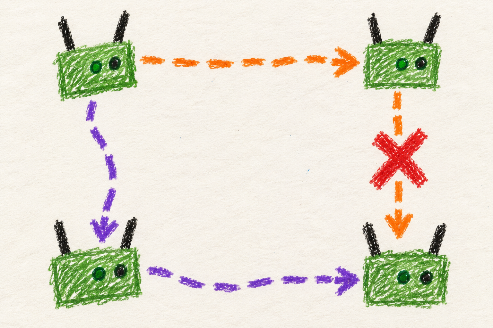

# Addresses and names

## Marine

### Every radio needs a place to get mail

Your radio picks some addresses. It keeps one for itself and gives one to
your phone. Other radios pick their own addresses.

If two radios pick the same space, one picks again. A phone may need to
reconnect while that happens.

Use **[manet.local](http://manet.local/)** to find the radio your phone is
plugged into.

Do not go near a road unless you are wearing your glow belt.

## User

### What an address does

An IP address is a numerical network address used to deliver information to a device. MANET
assigns these automatically, without a central server being in charge of the network.

Each radio reserves a small group of addresses from the mesh's shared
range. It uses one as its own mesh address, one as the local gateway for
attached devices, and the rest for those devices. The gateway is where a
phone, laptop, or other end user device (EUD) sends traffic that needs to leave its immediate network.

The number of attached devices allowed per radio is chosen during flashing. The intended use of these
radios is one radio to one EUD.  This setting is there to give you flexibility in your deployment.
The flashing script will calculate the number of radios and EUDs your chosen network range will
support, so be sure to check and confirm that before flashing.

### To connect to your own radio 

**[http://manet.local/](http://manet.local/)** opens the dashboard of the
radio serving your attached device. Every radio uses this same convenient
local name. It is not a name for one permanent central server, just the radio
between that EUD and the mesh.

The radio also has a hostname such as `mesh-1234` and a mesh address, visible
in its status details. These identify it to the rest of the system. Record
the hostname when reporting a fault, so another person knows which radio
you mean. Each radio's hostname is derrived from its hardware address and will
not change if re-flashed. If the convenient manet.local name fails, try the 
numerical local gateway address shown in your phone or computer's network details.

### Why an address might change

There is no central machine handing blocks to radios. Each radio listens
for existing claims and tries to choose free space. Two groups of radios that were
turned on when they were isolated can pick overlapping addresses. When they meet, 
the radios resolve the overlap and one changes its block. Simultaneous startup can also require
this automatic repair.

An address change can interrupt a connection. If your device retains its
old network details, disconnect and reconnect it so it can ask for an address again. Avoid
building a permanent configuration around a particular radio's current address
number unless you account for reallocation.

Some [shared services](services.md) have reserved service addresses that
can move between hosts. Those are separate from a radio's own address.
Changing the shared mesh address range affects all of them. Follow
[settings](settings.md) rather than editing one radio independently.
After a range change, each radio removes its old addresses, gateway and
service addresses before taking new ones, so reconnect your devices once the
change has finished.

## Developer

### One shared subnet, several address roles

The allocation of the network CIDR block provided during the setup script run
is divided into chunks.  The chunk size is the number of EUDs that each radio
should support (a setup script question) plus two. The two additional addresses
are the mesh facing and EUD facing IPs of the radios. The CIDR range reserves
the first five valid IP addresses for services, and then splits the remainder
up by the chunk size to determine the radio carrying capacity of that network
range.

### Discover, claim, reconcile

The radio's IPv6 address autoconfigures to the same /48 prefix, which is announced
by an identical RA service on all radios, providing
a usable IPv6 SLAAC network which can carry Alfred gossip data between radios.
Alfred carries radio metadata supplied by the radios, which include the IPv4 address
chunk they have selected.  A newly booted radio publishes local identity and telemetry,
observes a ten-second Alfred synchronization window, builds a local mesh node registry
from the Alfred data, and then selects an IPv4 allocation that is not yet claimed. 

A remembered allocation is reusable after a reboot only if it remains free under current
observations. Otherwise the allocator randomly chooses an available range,
applies its addresses and DHCP pool, and publishes the claim. Periodic
reconciliation repairs races and partition merges. For overlapping claims,
the higher MAC keeps its allocation and the lower MAC releases and reselects.

A CIDR change removes this node's old addresses, EUD gateway, old service
VIPs, DHCP pool and mDNS entry before taking new ones. Unrelated aliases on
the bridge are kept. If any step fails, the old DHCP service is put back and
the change is retried every 15 seconds.

A split mesh's convergence depends on an exchange of fresh claims. Unchanged
telemetry does not renew the observation age and stale peers eventually stop
reserving space. A returning node can therefore find its old allocation
occupied. The [allocation reference](../../../docs/node-tools-internals.md#ipv4-allocation-and-collision-recovery)
describes expiry, mixed-width collisions, and exhaustion behavior in full.

### Names follow ownership and discovery boundaries

`manet.local` points to every EUD's client-gateway address. DHCP and local
DNS/mDNS discovery are confined at the mesh bridge boundary so a different
radio cannot answer a local client's setup request or put unnecessary traffic
onto the mesh network. Network allocation changes made through the admin web panel
therefore require synchronized updates to addresses, DHCP, discovery, and
the management firewall's allowed source pool. A CIDR change retires the old
DHCP pool and mDNS entry together with the old addresses.

Peer hostname->ip mappings are a separate registry derived local hosts view.
A radio's /etc/hosts updater compares content before replacing to lower storage wear
and never sends network traffic to find the name of another radio. A known name 
or cached record establishes identity, not present reachability.
 Live BATMAN routes display reachable radios.

See [client packet paths](connect.md#developer-layer-2-topology-and-address-ownership)
and [service ownership](services.md#developer-ranking-and-stable-ownership).
