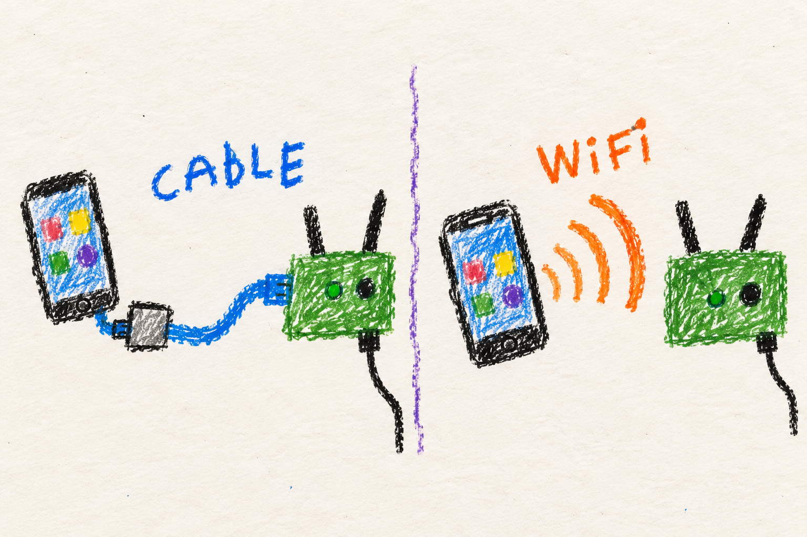

# Connect your device

## Marine

### Phone meets radio

- **Cable:** connect your phone or computer to the radio's Ethernet port.
- **Wi-Fi:** join the radio's access point, if it is enabled.
- **Open:** [http://manet.local/](http://manet.local/) to see status.
- **Change settings:** open [Manage](http://manet.local/manage/) and enter the admin password.

Wi-Fi access depends on how this radio was configured. If it is not serving an access point, use Ethernet.

## User

### Choose an available connection

An end-user device, or **EUD**, is the phone or computer attached to a radio. Use its Ethernet connection or its configured Wi-Fi access point. A phone may need a compatible Ethernet adapter.

| Mode | Behavior |
|---|---|
| Wired | Ethernet connects a client, or becomes an uplink if connected to an internet router. |
| Wireless | A local access point serves phones and computers. |
| Auto | The role depends on Ethernet detection and channel mode. A wired client takes priority over the AP. |

With automatic channels enabled, Auto serves an AP when the radio is a gateway; otherwise the AP candidate radio participates in the mesh. If you need a dedicated wireless client connection, select the appropriate EUD mode when configuring the radio.

### Open the local dashboard

From a device connected to this radio, visit **[http://manet.local/](http://manet.local/)**. You can also use the radio's local address. The status page shows topology, node details, and link information without a password.

**[http://manet.local/manage/](http://manet.local/manage/)** opens management. Sign in with the admin password chosen during flashing. Management includes radio controls, measurements, configuration, and voice status.

The dashboard is for this radio's own clients. A device on the upstream internet router or attached to another radio is not automatically allowed to open it.

### ATAK phones

The current ATAK integration uses a wired phone connection and additional ATAK settings. Follow the [ATAK phone instructions](../../../README.md#atak-phones). Joining the radio's Wi-Fi is not a substitute for the wired admission path.

## Developer

### Layer 2 topology and address ownership

Each node claims an IPv4 block sized `max_euds_per_node + 2`. Its first address is the primary mesh address on `br0`, its second is the local EUD gateway address, and the remaining addresses form its DHCP pool. `br0` bridges `bat0`; separate address roles do not by themselves isolate clients.

`ethernet-autodetect.sh` classifies Ethernet as an uplink when DHCP answers, or an EUD path otherwise. Dispatcher hooks and the AP/mesh role helpers reconcile bridge membership, addressing, gateway advertisement, and access-point ownership. The AP's candidate mesh role is preserved for its return to mesh operation.

### Management and discovery boundaries

`mesh-status.py` serves the public status routes and mixes in `manet_manage.py` for authenticated management on port 80. Both application checks and nftables policy enforce local-client access. Authentication alone does not bypass that network boundary.

`manet-dhcp-isolation.py` keeps DHCP and local discovery protocols from spreading over the mesh. `manet.local` resolves to the local EUD gateway address, independently of elected service VIPs. Discovery confinement must preserve intentional mesh transports such as voice and ATAK.

### AP ownership during ACS

With `acs=y` and Auto EUD mode, an Ethernet gateway can serve the AP while its other radios keep mesh connectivity. The AP candidate's stored mesh configuration follows the agreed channel plan. When the last uplink is removed, it returns to mesh operation on that plan. Gateways do not perform tourguide excursions.

The source and role-state contract are more specific than the shorthand “Auto means wireless until a cable appears.” Check the ACS and gateway conditions whenever changing these instructions.

### ATAK boundary

`manet-atak.service` is enabled by default; `atak=n` explicitly opts out. Admission requires the verified wired EUD path, a matching FDB/neighbor mapping, and the owned firewall policy. No admitted phone means no CoT output. `manet-positioning.service` is a separate, disabled-by-default service.

- [Networking and EUD reference](../../../MANET/node_tools/README.md#network-management)
- [Discovery boundary internals](../../../docs/node-tools-internals.md#local-eud-discovery)
- [Web interface internals](../../../docs/node-tools-internals.md#web-interface)
- [Dispatcher hooks](../../../MANET/networkd-dispatcher/README.md)
