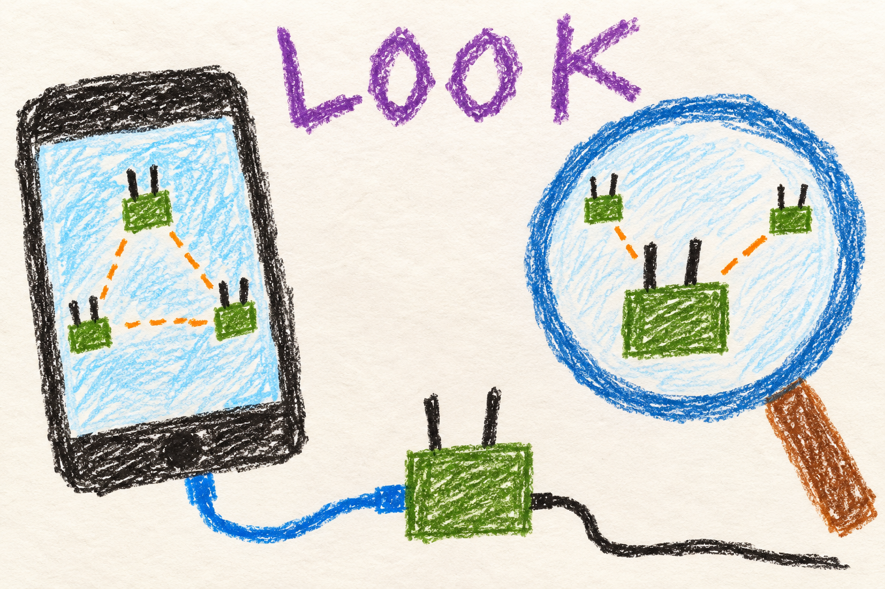
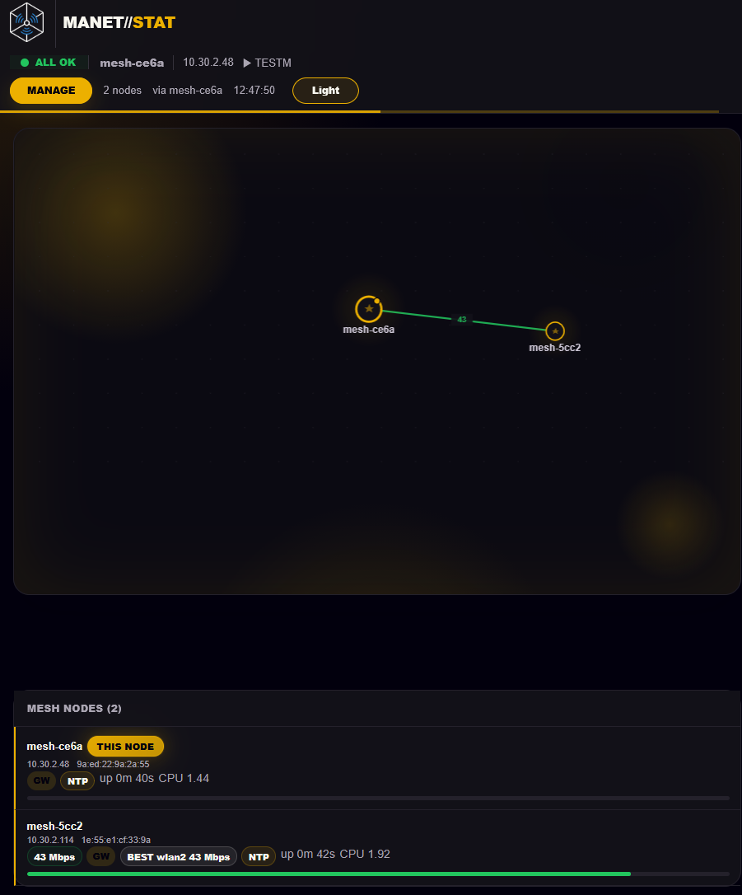

# Read the dashboard

## Marine

### Look. Tap. Look closer and then think.

1. **Connect to your radio.** Use its cable or Wi-Fi access point.
2. **Open [the status page](http://manet.local/).** Look for the radios you expect.
3. **Tap a radio.** See its connections and details.

A radio being on does not mean it can hear the others. A line on the map does not promise a particular download speed.

Need to change something? Open [Manage](http://manet.local/manage/) and use the admin password.

## User

### Start with the status page

Connect your phone or computer to the radio you want to inspect, then open **[http://manet.local/](http://manet.local/)**. The status page needs no password and refreshes about every 15 seconds while visible. If the name does not resolve, use that radio's local IP address. See [device connections](connect.md) if you cannot reach it.

The topology shows the mesh as seen by this radio. Expand a node to inspect its addresses, uptime, radio interfaces, attached devices, and hosted services. GPS and battery information appear when available. Check which interface carries a route: a peer may still be reachable through HaLow even when its Wi-Fi link is absent.

### Understand what the numbers mean

Link values in Mbit/s are BATMAN's estimate of throughput for choosing paths. They are not the result of a file transfer or a speed test. A high radio connection rate also does not guarantee that an application will achieve that speed across several hops.

Peer information is shared over the mesh and can arrive later than a local change. Pay attention to stale or missing observations. Setup LEDs tell you whether provisioning finished; they do not prove that another radio is reachable.

### Find the right management tab

Open **[Manage](http://manet.local/manage/)** and sign in with the admin password chosen at flashing time. The Wi-Fi password and the management password serve different purposes.

| Tab | Use it for |
|---|---|
| Topology | Inspect nodes and their interfaces. |
| Radio config | Radio on/off, supported channel controls, and Wi-Fi transmit power. |
| Measure | Run throughput or ping measurements. |
| Sessions | Review and download saved measurement results. |
| Uplink | Configure USB Wi-Fi internet uplink credentials. |
| Voice | Check audio health, choose a talk group, or coordinate a codec change. |
| Node config | Change local client settings and shared mesh settings. |

See [changing settings](settings.md) before applying a change that could disconnect the mesh.

### Check recovery and measure a path

Expand **Mesh recovery** in management or this node's status panel. It explains observed and agreed Wi-Fi channels, acknowledgements, recovery holds, and the last verified clock source. A ready HaLow interface alone is not evidence of a connected peer.

For an actual performance check, use **Measure**, select the endpoints, direction, and test, then keep the radios in place while it runs. Throughput tests use the network, so schedule them when that traffic will not disturb voice or other work. Use a meaningful session label and export results from **Sessions** for comparison.

Your login lasts up to 48 hours on this radio. A reboot, web-service restart, or admin-password change requires a new login. An expired login does not mean the mesh has failed.

For test selection and interpretation, continue to
[measure a connection](measurements.md). The [radio controls](radios.md),
[internet](internet.md), [services](services.md) and [power](power.md)
chapters explain the corresponding status and management results.

## Developer

### One server, local observations

`mesh-status.py` serves port 80 and includes the management handlers from
`manet_manage.py`. Public read-only routes include `/api/data`, `/api/local`,
`/api/peer/<ip>`, and `/api/debug`. Management and `/api/admin/*` require a
session. Application checks admit localhost and the mesh/EUD subnet;
`manet-ui-firewall.sh` narrows this to localhost and this node's client pool,
as described in the [connection guide](connect.md).

The server combines live BATMAN originator, neighbor, and gateway queries with `/var/run/mesh_node_registry`, `/etc/mesh.conf`, and allocation state. Peer details come from Alfred-derived records, even when the route is named `/api/peer/<ip>`; it does not fetch a remote node's HTTP page. `manet_peer_radios.py` reconstructs compatible interface displays when older records lack structured interface telemetry.

This is a local observer of a distributed system, so the displayed fields do
not all describe one instant:

| Observation | What it establishes | What it does not establish |
|---|---|---|
| Live BATMAN originator/neighbor query | The local forwarding view and available next-hop information | That every other node sees the same topology |
| A peer's Alfred telemetry | The last reported radio, service, and operating state | The peer's current settings between publications |
| Local allocation and configuration | Which addresses/settings this node owns or intends to use | Successful remote application of a shared change |
| A measurement result | Observed traffic performance between its endpoints during that test | Permanent capacity or a guaranteed radio path |

Identity and telemetry join on the Alfred publisher MAC. To avoid making a
cached record look alive forever, the registry refreshes a peer's observation
age only when its telemetry payload changes. Local boot time measures that
age even before clocks synchronize. After 300 seconds without a change the
registry marks it stale and removes its address claim. The dashboard's
short HTTP cache sits on top of this longer publication/freshness process;
refreshing the browser cannot force a peer to publish new measurements.
See [registry freshness](../../../docs/node-tools-internals.md#data-management).

### Freshness, load, and sessions

Status collections share a five-second cache, with two seconds for voice and configuration. At most eight HTTP connections and two status collections run concurrently. A busy server can return 503 with a retry delay. Background tabs stop polling. These bounds protect radio work from dashboard load.

`manet_recovery_status.py` combines local ACS, last-channel-change, and time-client state with the registry. Observations older than 45 seconds are not treated as current recovery evidence. Display failures must not stop control or recovery.

`manet_web_sessions.py` keeps token digests and monotonic 48-hour deadlines in memory. Sessions are per node, with no sliding idle extension or peer replication. Tests or tooling that restart the server must sign in again.

Concurrent viewers share fixed cache keys, so opening more tabs does not
create an independent radio-query workload for every request. Management
writes are serialized and invalidate cached observations when they finish;
authentication is checked before cached management data is served. A 503
therefore can mean that the observation budget is busy, not that the mesh
has lost all peers.

A session uses a random token whose digest and absolute deadline stay in
the web process. Monotonic timing prevents an NTP/GPS correction from
extending the login. Restarting the process loses the session store, while
an observed admin-password change invalidates existing sessions. This is
separate from persistent replay protection for commands sent between radios:
being logged into the UI does not itself prove a peer accepted an action.

### Measurements and evidence

Measurements run `iperf3` or `ping` against the selected peer. They do not use the encrypted configuration transaction path. Record endpoints, direction, selected route, radio settings, and physical conditions when interpreting results; a dashboard estimate cannot establish the actual packet path or end-to-end throughput.

- [Web routes, limits, and management reference](../../../MANET/node_tools/README.md#web-interface)
- [Web implementation and recovery display internals](../../../docs/node-tools-internals.md#web-interface)
- [Status server](../../../MANET/node_tools/mesh-status.py)
- [Management implementation](../../../MANET/node_tools/manet_manage.py)
