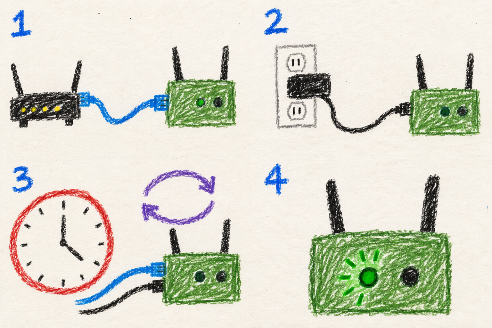

# The first boot

## Marine



1. **Internet cable in.** Connect the radio to an internet router with Ethernet, using your blue internet hose.
2. **Power in.** Leave both power and network cables connected.
3. **Wait about ten minutes.** The radio restarts itself a few times during setup.
4. **Green heartbeat, red off.** On a CM4 these little blinking lights tell you when setup is complete.

**Red heartbeat and green solid?** Setup did not finish. This is bad, but sometimes even friends make mistakes. Check the internet cable and power, then reboot and it will try again.

The green heartbeat reports setup completion. Check the dashboard to see whether other radios are connected.

## User

### Connect, then let it finish

After [flashing](flash.md), insert the storage if it is removable (an eMMC enabled CM4 is the intended hardware). Connect the Ethernet port to a router with internet access, then connect a reliable power supply. Keep both connected while setup runs.

The radio downloads the selected MANET release, installs its software, configures the radios, and restarts several times. Allow about ten minutes; download speed and hardware affect the time needed.

### Read the result

When using a Waveshare IO-BASE-A carrier board, the onboard LEDs report the provisioning result:

| LEDs | Meaning | Next step |
|---|---|---|
| Green heartbeat, red off | Setup completed | [Connect your phone or computer](connect.md). Radio is ready to use. |
| Red heartbeat, green solid | Setup did not complete | Restore Ethernet internet access and steady power, then reboot to retry. |
| No final pattern yet | No completed result is shown | Leave power and Ethernet connected while setup continues. |

The status pattern is restored at each boot. It reports setup completion, not the number of mesh neighbors. Other boards may expose different LED names or no usable pair; the SSH login banner also reports provisioning status.

### If setup needs attention

The SSH login banner clearly describes the status of the radio, from initial setup to completion. Detailed setup log is `/var/log/radio-setup.log`.

Additional, user added setup scripts have their own result and log, `/var/log/manet-user-scripts.log`. A failed additional script does not turn a successfully provisioned radio into a failed installation.

[Full provisioning reference](../../../MANET/provisioning/README.md#first-boot)

## Developer

### Provisioning has distinct stages

On Raspberry Pi targets, the image's `firstrun.sh` creates the radio user account, enables SSH, and installs the next provisioning stage's script. Rock 3A image preparation embeds the provisioning service and configuration directly in the Armbian image. Both paths ultimately schedule `radio-setup-run-once.service` after the wireless interfaces exist.

The release URL, SHA-256, and expected version are baked into the provisioning script at flash time. First boot validates that selection before extracting its archive. The kernel-protection helper runs before provisioning's APT operations. The certificate/date handling needed for a cold clock is deliberately limited to the provisioning path; see [download verification and kernel protection](../../../docs/provisioning-internals.md#first-boot-without-a-trusted-clock).

These stages cross reboot boundaries because they have different hardware
prerequisites. The initial image can create accounts and arrange network
provisioning, but final radio-role assignment needs the MANET drivers, which exist in the downloaded kernel, 
and the interfaces present in order to set them up. The installed run-once service supplies
that continuation. Seeing the machine boot or accept SSH therefore does not
mean its radio configuration is complete.  Completed setup is displayed as an SSH banner and heartbeat blinks on the Waveshare IO-BASE-A.

| Stage | Main responsibility | Evidence that matters |
|---|---|---|
| Image bootstrap | Establish the account and arrange network provisioning | The next provisioning stage is installed/enabled |
| Network provisioning | Fetch the pinned board package, verify it, protect kernel ownership, and install dependencies/payload | Package identity checks and provisioning logs |
| Final radio setup | Discover hardware, assign roles, generate configuration, and start services | Recorded setup failures, pending renames, and the final provisioning verdict |
| Operator scripts | Run the separately embedded customization scripts | Their own completion records and log |

A fresh radio may have no trusted date, which would make normal certificate
and package-metadata date checks fail. The provisioning path removes CA checks for some initial downloads but limits its
exception to pinned downloads whose bytes must match the digests
baked into the image. APT retains signature/hash verification while metadata
date checks are temporarily relaxed for the provisioning process. These
exceptions are removed at phase completion; they do not become the runtime
updater's trust policy.

### Final radio setup

`radio-setup.sh` serializes setup with a process lock, classifies PHY capabilities into radio roles and expected wlan numbers, writes MAC-pinned interface names, generates supplicant and networkd configuration, and enables the runtime services. If names need to settle across a reboot, it retains the run-once unit for retry. Later boots use `manet-radio-names.service` to resolve naming collisions before network services start.

The orchestrator entry point is a **symlink**, selected by `node-manager-select.sh` from `acs=`. It points to `node-manager-acs.sh` or `node-manager-static.sh`; there is no independently maintained `node-manager.sh` source file.

Radio roles follow capability and identity rather than the order in which
drivers happened to create interfaces. Setup probes the PHYs, assigns the
available bands and AP role, and pins names by MAC. If two devices currently
occupy one another's desired names, a later boot's naming service moves them
aside before assigning the final names. Keeping the run-once service enabled
through a required rename reboot lets configuration resume against stable
names instead of marking a half-configured layout complete.

The setup lock prevents two invocations from rewriting those roles and the
provisioning verdict concurrently. Recoverable step failures are recorded;
the final success verdict depends on reaching completion without recorded
failures. Rerunning setup can regenerate the live configuration, which is why
the failed phase should be identified before using a rerun as a remedy.
The [final-setup reference](../../../MANET/provisioning/README.md#final-setup-radio-setupsh)
describes the generated network and service configuration.

Successful final setup records completion and disables the run-once service. Additional operator scripts run separately after successful provisioning, with their own per-script completion records. Their failure is advisory and does not rewrite the radio's provisioning verdict.

### Completion and diagnostics

`manet-provision-status.sh` and `manet-led-status.sh` read `/var/lib/manet-provision.state`, with `/var/lib/radio-setup.done` as the fallback completion proof. The LED helper maps `complete` to green heartbeat/red off, `incomplete` to red heartbeat/green solid, and leaves the boot pattern unchanged for other states. Missing LED hardware is tolerated.

```bash
sudo manet-provision-status.sh
sudo journalctl -u radio-setup-run-once.service -b
sudo tail -n 100 /var/log/radio-setup.log
```

Inspect the recorded phase and failures before rerunning setup: setup regenerates radio configuration. A completed provisioning marker alone does not prove RF connectivity, a usable uplink, or functioning audio hardware.

### Implementation references

- [Provisioning stages and final setup](../../../MANET/provisioning/README.md#final-setup-radio-setupsh)
- [Provisioning internals](../../../docs/provisioning-internals.md)
- [Provisioning status reader](../../../MANET/node_tools/manet-provision-status.sh)
- [LED verdict implementation](../../../MANET/node_tools/manet-led-status.sh)
- [Orchestrator selector](../../../MANET/node_tools/node-manager-select.sh)
