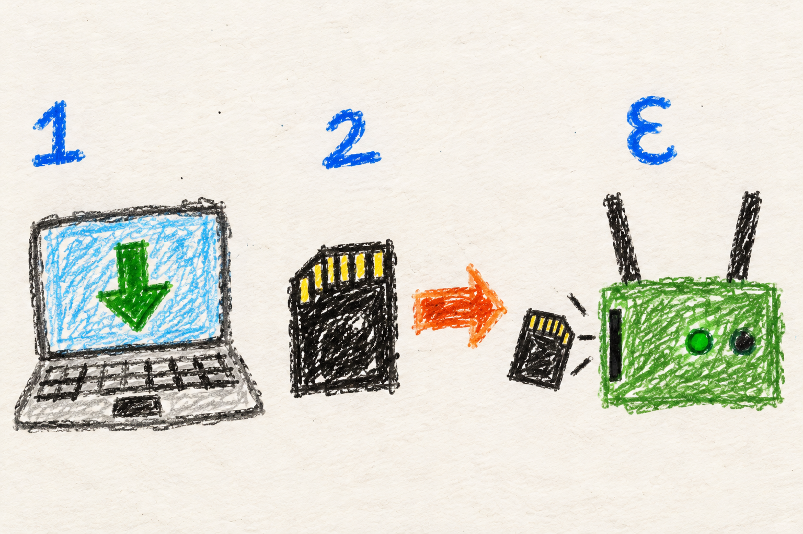

# Flash a radio

## Marine



### Put the software on the radio

1. **Get the flasher.** [Windows](https://github.com/very-srs/MANET/releases/latest/download/Flash-a-Radio.cmd) or [Linux](https://github.com/very-srs/MANET/releases/latest/download/flash-a-radio.sh).
2. **Pick your board.** Enter and save the settings for your mesh. You can ask a friend to read the words if you get confused.
3. **Check the drive.** Flashing erases the selected storage. Look at it twice to make sure it is the right thing being deleted.
4. **Keep your login.** Save the SSH username and passwords shown when flashing finishes. Then follow [first boot](first-boot.md).

The phone Wi-Fi name you choose here stays with the radio.

A CM4 with built-in eMMC uses USB boot access instead of a removable card. Follow the flasher's hardware instructions.

No internet where the radio is going? Tick **Offline setup** before you flash. The card then carries everything the radio needs.

## User

### Choose your computer

On **Windows**, download [Flash-a-Radio.cmd](https://github.com/very-srs/MANET/releases/latest/download/Flash-a-Radio.cmd) and double-click it. The launcher downloads the flasher. The wizard checks for the required tools and offers to install them.

On **Linux**, download [flash-a-radio.sh](https://github.com/very-srs/MANET/releases/latest/download/flash-a-radio.sh), then run:

```bash
chmod +x flash-a-radio.sh
./flash-a-radio.sh
```

Run the Linux flasher as your regular user. It requests elevated access when it needs to write storage. Python 3 and curl are needed to start the launcher.

### Enter the mesh settings

Select the board, then configure the mesh SSID and SAE key, network CIDR, regulatory region, EUD connection mode, SSH username and password, and web admin password. Radios intended for the same mesh need compatible mesh settings. The admin password is shared across the mesh. Local access-point settings belong to each radio.

For Wireless or Auto client mode, choose the SSID for the radios.  All radio APs get
this name, but each one adds four alphanumeric characters to the end to uniquely identify each radio.
This name is fixed after flashing so the radios can recognize their own
hotspots when choosing an internet connection. Its password remains editable
in Node config. Wired-only flashing leaves the phone Wi-Fi name empty.

The **SSH username** is the Linux account used to log in to the radio. It
defaults to `radio` and is editable. The **SSH password** belongs to that
account. The **Web interface admin password** unlocks the management page.
Use CIDR notation such as `10.30.2.0/24` for the network, not a start–end
address span. Save the login details shown when flashing finishes.

Saved configurations can be reused by the Windows and Linux flashers. 
Optional additional setup scripts are embedded at flash time to be run on the node after successful provisioning.

EUD style starts with **Wired** connections selected. Choose
**Show services and addressing** to change services or the network range. **Next**
offers to save edited settings, continue without saving, or keep editing.
On the setup scripts page, select **Show ignored files and documentation**
if you want to see files that will not run.

### Check the storage before writing

Flashing erases the selected card or eMMC. Review the device and configuration before confirming. A CM4 with eMMC needs its carrier board in USB boot mode and `rpiboot` access. The [complete guide](../../../MANET/provisioning/README.md) covers the host and board requirements.

The Windows disk list hides fixed and internal drives by default. Select
**Show fixed / internal drives (advanced)** only when needed, and check the
device type, size, and contents before selecting a drive. The computer's
boot disk is never listed.

The normal flasher selects the stable GitHub release marked **Latest**. Use `--development` only when you intend to test the most recently published build, including prereleases.

### Set up radios without internet

A radio normally needs Ethernet with internet the first time it starts, because it downloads its software during [first boot](first-boot.md). **Offline setup** puts everything it needs on the card instead, and the radio then sets itself up with no network connection at all. It works for the Compute Module 4 and the Raspberry Pi 4B.

If the computer you flash from has internet, tick **Offline setup** on the Windows confirmation page, or start the Linux flasher with `./flash-a-radio.sh --offline`. Offline setup needs Raspberry Pi Imager 1.9 or later. If yours is older, the Windows prerequisites page shows **Update it**, and the Linux flasher offers to download a newer copy for itself.

If the computer you flash from has no internet, prepare a USB stick on another computer that does. On Linux, run:

```bash
./flash-a-radio.sh --make-kit /media/usb/manet-kit
```

On Windows, run `"Flash-a-Radio.cmd" --make-kit E:\manet-kit` from Command Prompt. This puts about 860 MB on the stick: both flashers, the Raspberry Pi OS image, the MANET software for one release, and copies of Raspberry Pi Imager and rpiboot. Take the stick to the offline computer and run the flasher from the kit folder. Double-click `Flash-a-Radio.cmd` on Windows, or run `bash flash-a-radio.sh` on Linux. Every card it writes is set up for offline use, and nothing is downloaded. If that computer has no Raspberry Pi Imager 1.9 or later, the flasher uses or offers the one on the stick. A CM4 also needs `rpiboot`. Windows can install it from the stick. On Linux, install it before the computer goes offline.

When a card is done, the flasher says that it carries everything the radio needs. If it says the card is not ready for offline setup, flash that card again.

When writing completes, proceed to [first boot](first-boot.md). Flashing storage and provisioning the running radio are separate stages.

## Developer

### Launchers select a complete release

The standalone launchers resolve a published MANET release and verify its flasher ZIP against the manifest's size and SHA-256. Stable selection uses Latest. `--development` selects the most recently published eligible build. Selection supplies setup scripts and the board package together.

The selected release is the consistency boundary between the computer doing
the imaging and the radio doing first boot. The launcher first obtains the
release manifest, then uses the selected tag's fixed URLs for the setup
bundle and board package. It does not keep asking for "whatever is latest"
at each step. Otherwise a publication between imaging and first boot could
pair one version's generated configuration with another version's installer.

| Step | Information carried forward | Check before proceeding |
|---|---|---|
| Select release | Version, board assets, sizes, and digests from the manifest | Stable versus explicit development selection |
| Fetch setup bundle | The selected release's flasher ZIP | Size and SHA-256 match the manifest |
| Render first boot | Board install URL, expected digest/version, and operator settings | All required template values and script anchor are handled |
| Boot the radio | The already selected package identity | Download or card copy digest and both embedded version markers agree before extraction |

SHA-256 detects content that differs from the selected manifest. It does
not independently establish who authorized the manifest. The release
selection and download path provide that trust context. A failed fetch or
verification stops the launcher rather than silently switching channels or
using an unrelated cached build.

`MANET_RELEASE_FILE` passes the selected manifest into the engine. `MANET_FLASHER_WORK` keeps settings, downloads, and additional scripts outside the temporary extracted ZIP. `--local-scripts` runs a checkout's setup code against the selected published board package. It does not publish or package that checkout.

### Offline setup

An offline card carries two release files in the root of its boot partition: `cm4-install.tar.gz` and `cm4-offline.tar`. The second is built for each release by `MANET/packaging/build-offline-bundle.py`. It resolves every apt install that first boot and radio-setup run, against the exact Raspberry Pi OS image the flashers write and after the same kernel protection, and adds yq, MediaMTX, and a version marker. `publish.py` checks the bundle against the committed version, image, and pins, and records the image in the manifest as `os_image`. The current bundle holds 163 packages, about 175 MiB.

`--offline`, or the Windows checkbox, makes the engine fetch both files into `packages/` and check them against the manifest. `--make-kit` fills a folder with both launchers, the flasher ZIP, the manifest, the image, both files, and a `tools` folder holding the Raspberry Pi Imager and rpiboot files pinned in `flasher-tools.json`, and marks it with `MANET-OFFLINE-KIT.txt` once it is complete. A launcher that finds that marker beside it reads everything from the kit, checks it against the kit's manifest, and makes no network request. After rpi-imager writes a card, the engine copies both files onto its boot partition and checks each copy against its digest. That only works if the imager leaves the card attached, so the engine passes `--disable-eject`, which 1.9 added, and refuses offline setup with an older imager before any card is written. A card that does not get both files is a failed flash. Without the option the engines download nothing extra and call rpi-imager with the same arguments as before.

The flasher pins the bundle's SHA-256 in the first-boot script as `__OFFLINE_SHA256__`, which is empty on other flashes. When both files on the card match their pinned digests, first boot skips the network readiness gate. It unpacks the bundle into `/var/lib/manet-offline` and writes one apt drop-in that makes the bundle the only package source. Every later apt command, radio-setup's included, then installs from the card. radio-setup removes the drop-in and the unpacked bundle after it records a complete setup, and the card copies are deleted once the earlier provisioning stage is disabled, so a failed run retries with them. The [internals reference](../../../docs/provisioning-internals.md#offline-setup) covers the bundle build, the kit checks, the card copy, and the trust model of the local repository.

### Fixed phone hotspot identity

Both flashers and provisioning templates still supply `lan_ap_ssid`.
Radio setup records the full name in `/var/lib/manet-ap-ssid` before other
setup writes, including on wired nodes with an empty name. Later API edits,
config activation, and setup reruns cannot rename it. The fixed base is the
literal prefix used to exclude mesh phone hotspots from Wi-Fi uplinks.
See [settings](settings.md#developer-keep-local-and-shared-settings-separate).

### Template rendering

`linux-flasher.sh` and `windows.ps1` substitute matching `__TOKEN__` values in the Raspberry Pi and Rock 3A templates. The Windows GUI feeds the same configuration and rendering engine as its console path. A new setup option must reach both host substitution paths and both applicable templates.

`manet-flasher.ps1` owns the Windows layout, field validation indicators,
and saved-configuration state. It compares current form values with a
snapshot taken after loading or saving to detect unsaved edits. The GUI
filters the engine's candidate disks to removable media unless the operator
enables fixed drives. This filter does not replace the engine's exclusion
of the boot disk or the final write confirmation.

Both templates contain `# >>> MANET_ADDITIONAL_SCRIPTS <<<`. The flasher inserts operator scripts at that anchor **after** token substitution. Appending scripts at the end is incorrect because the Rock 3A template ends in a reboot. Operator script content must not be treated as template tokens.

Rendering has two kinds of input with different ownership. Structured
settings belong to the provisioning template and must be substituted by
both host engines. Operator scripts are opaque content: a string inside
one that happens to resemble a template token must survive unchanged.
Substitution before script insertion maintains that boundary. The saved
configuration, the rendered script, and the selected release should therefore
be inspected together when diagnosing a setting that did not reach a radio.
The [template contract](../../../docs/provisioning-internals.md#template-tokens)
identifies the shared substitution paths.

The rendered first-boot script pins the selected install URL, digest, and version. A later release cannot change that image's package target. An image pinned to a prerelease whose assets were deleted needs to be reflashed with a retained release.

### SSH account selection

Saved configurations carry `RADIO_USER`, and both host engines substitute
`__RADIO_USER__` into provisioning. Missing keys default to `radio` on each
load. Usernames are validated before writing an image. Both templates save
`ssh_user` in `/etc/mesh.conf`, so SSH recovery and services using the
account's home directory follow the selected name. Runtime configuration
changes preserve this local setting. Editing it is not a supported way to
rename an existing account.

### Review points for changes

Check Linux and Windows rendering, saved configuration compatibility, unexpanded tokens, script embedding, and release selection. Prove rendered outputs as well as the form or prompt that collects a value. Storage-writing checks require disposable media. Rendering checks alone do not establish hardware flashing behavior.

- [Token list and rendering internals](../../../docs/provisioning-internals.md)
- [Host requirements and user workflow](../../../MANET/provisioning/README.md)
- [Additional-script contract](../../../MANET/provisioning/additional-scripts/README.md)
- [Release manifest and publication](../../../MANET/releases/README.md)
