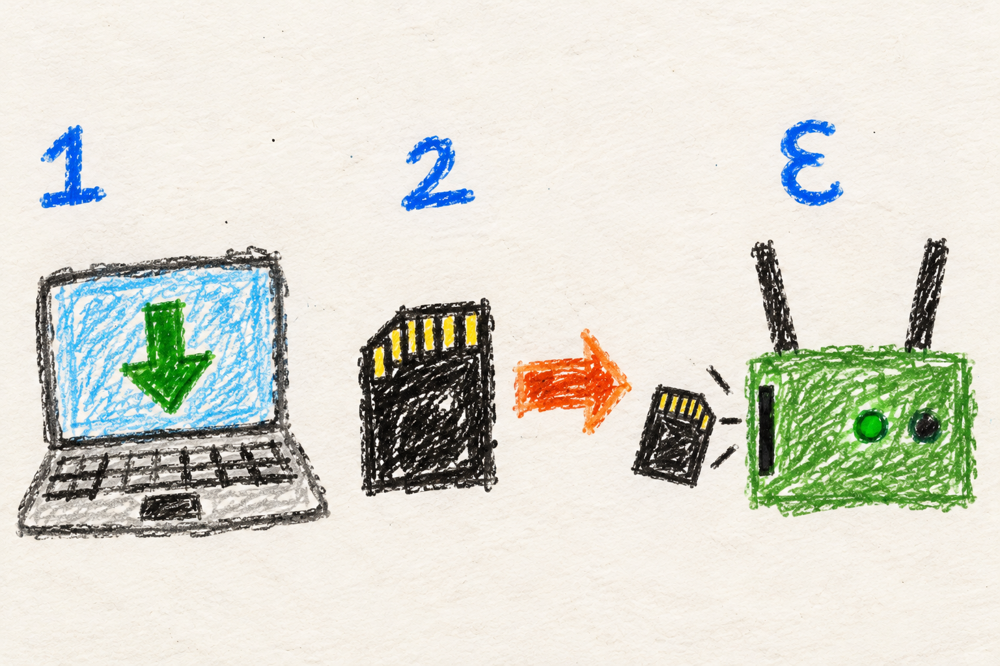

# Flash a radio

## Marine



### Put the software on the radio

1. **Get the flasher.** [Windows](https://github.com/very-srs/MANET/releases/latest/download/Flash-a-Radio.cmd) or [Linux](https://github.com/very-srs/MANET/releases/latest/download/flash-a-radio.sh).
2. **Pick your board.** Enter the settings for your mesh.
3. **Check the drive.** Flashing erases the selected storage.
4. **Let it finish.** Then follow [first boot](first-boot.md).

A CM4 with built-in eMMC uses USB boot access instead of a removable card. Follow the flasher's hardware instructions.

## User

### Choose your computer

On **Windows**, download [Flash-a-Radio.cmd](https://github.com/very-srs/MANET/releases/latest/download/Flash-a-Radio.cmd) and double-click it. The launcher downloads the flasher. The wizard checks for the required tools and offers to install them.

On **Linux**, download [flash-a-radio.sh](https://github.com/very-srs/MANET/releases/latest/download/flash-a-radio.sh), then run:

```bash
chmod +x flash-a-radio.sh
./flash-a-radio.sh
```

Run the Linux flasher as your regular user. It requests elevated access when it needs to write storage. Python 3 and curl are needed to start the launcher.

### Enter the mesh settings

Select the board, then configure the mesh SSID and SAE key, network range, regulatory region, device connection mode, and passwords. Radios intended for the same mesh need compatible mesh settings. The admin password is shared across the mesh; local access-point settings belong to each radio.

Saved configurations can be reused by the Windows and Linux flashers. Optional additional setup scripts are embedded at flash time and run on the node after successful provisioning.

### Check the storage before writing

Flashing erases the selected card or eMMC. Review the device and configuration before confirming. A CM4 with eMMC needs its carrier board in USB boot mode and `rpiboot` access; the [complete guide](../../../MANET/provisioning/README.md) covers the host and board requirements.

The normal flasher selects the stable GitHub release marked **Latest**. Use `--development` only when you intend to test the most recently published build, including prereleases.

When writing completes, proceed to [first boot](first-boot.md). Flashing storage and provisioning the running radio are separate stages.

## Developer

### Launchers select a complete release

The standalone launchers resolve a published MANET release and verify its flasher ZIP against the manifest's size and SHA-256. Stable selection uses Latest; `--development` selects the most recently published eligible build. Selection supplies setup scripts and the board package together.

The selected release is the consistency boundary between the computer doing
the imaging and the radio doing first boot. The launcher first obtains the
release manifest, then uses the selected tag's fixed URLs for the setup
bundle and board package. It does not keep asking for "whatever is latest"
at each step. Otherwise a publication between imaging and first boot could
pair one version's generated configuration with another version's installer.

| Step | Information carried forward | Check before proceeding |
|---|---|---|
| Select release | Version, board assets, sizes, and digests from the manifest | Stable versus explicit development selection |
| Fetch setup bundle | The selected release's flasher ZIP | Size and SHA-256 match the manifest |
| Render first boot | Board install URL, expected digest/version, and operator settings | All required template values and script anchor are handled |
| Boot the radio | The already selected package identity | Download digest and both embedded version markers agree before extraction |

SHA-256 detects content that differs from the selected manifest; it does
not independently establish who authorized the manifest. The release
selection and download path provide that trust context. A failed fetch or
verification stops the launcher rather than silently switching channels or
using an unrelated cached build.

`MANET_RELEASE_FILE` passes the selected manifest into the engine. `MANET_FLASHER_WORK` keeps settings, downloads, and additional scripts outside the temporary extracted ZIP. `--local-scripts` runs a checkout's setup code against the selected published board package; it does not publish or package that checkout.

### Template rendering

`linux-flasher.sh` and `windows.ps1` substitute matching `__TOKEN__` values in the Raspberry Pi and Rock 3A templates. The Windows GUI feeds the same configuration and rendering engine as its console path. A new setup option must reach both host substitution paths and both applicable templates.

Both templates contain `# >>> MANET_ADDITIONAL_SCRIPTS <<<`. The flasher inserts operator scripts at that anchor **after** token substitution. Appending scripts at the end is incorrect because the Rock 3A template ends in a reboot. Operator script content must not be treated as template tokens.

Rendering has two kinds of input with different ownership. Structured
settings belong to the provisioning template and must be substituted by
both host engines. Operator scripts are opaque content: a string inside
one that happens to resemble a template token must survive unchanged.
Substitution before script insertion maintains that boundary. The saved
configuration, the rendered script, and the selected release should therefore
be inspected together when diagnosing a setting that did not reach a radio.
The [template contract](../../../docs/provisioning-internals.md#template-tokens)
identifies the shared substitution paths.

The rendered first-boot script pins the selected install URL, digest, and version. A later release cannot change that image's package target. An image pinned to a prerelease whose assets were deleted needs to be reflashed with a retained release.

### Review points for changes

Check Linux and Windows rendering, saved configuration compatibility, unexpanded tokens, script embedding, and release selection. Prove rendered outputs as well as the form or prompt that collects a value. Storage-writing checks require disposable media; rendering checks alone do not establish hardware flashing behavior.

- [Token list and rendering internals](../../../docs/provisioning-internals.md)
- [Host requirements and user workflow](../../../MANET/provisioning/README.md)
- [Additional-script contract](../../../MANET/provisioning/additional-scripts/README.md)
- [Release manifest and publication](../../../MANET/releases/README.md)
