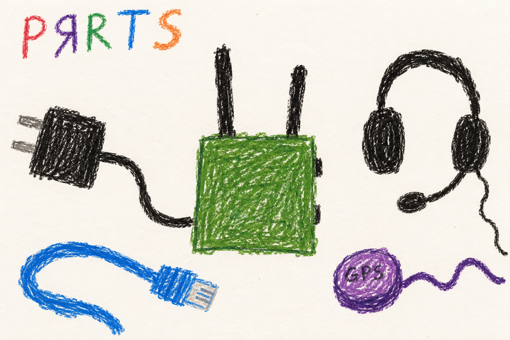

# Hardware and accessories

## Marine

### Give the radio what it needs

- **Power** keeps it awake.
- **Antennas** help it hear other radios.
- **A cable** connects your phone or computer.
- **A headset** lets you talk and listen.
- **A GPS receiver** helps it find where it is and what time it is.

The picture shows the parts' jobs. It is not an assembly diagram.

## User

### Choose a supported computer

A MANET radio contains a small Linux computer and its radio hardware. The
computer, wireless cards, antennas, power supply and enclosure need to work
together. A supported computer alone is not a complete radio.

| Computer | Current project status |
|---|---|
| Raspberry Pi Compute Module 4 (CM4) | Primary development and verification target; supports conventional Wi-Fi and HaLow. |
| Raspberry Pi 4B | Briefly tested; its lack of the required PCIe connection limits its usefulness here to HaLow. |
| Raspberry Pi 5 | Functional, but its project support is out of date and it is not the current focus. |
| Radxa Rock 3A | Functional, but not the current focus. |

The Pi 5 and Rock 3A have run too hot for the intended sealed enclosure.
The CM4 is the best-documented starting point for following this project's
current development. Carrier boards and wireless cards not listed here may
need changes before they work.

### What each part contributes

Conventional Wi-Fi and HaLow are the links **between radios**. A local Wi-Fi
access point, when enabled, is a separate job: connecting your phone to its
radio. An Ethernet adapter provides the wired alternative for a phone.
See [connections](connect.md) and [radio controls](radios.md).

A GPS receiver supplies position and can supply time. A radio without its own
GPS can obtain time from another suitable node, but that does not give it a
GPS position. See [time](time.md) and [location](location.md).

Voice needs a supported audio device, microphone/headset and physical PTT
input. Opening the dashboard on a phone does not turn the phone into a
microphone. Follow the [voice guide](voice.md).

### Before sealing an enclosure

Confirm that the actual assembled radio can boot, connect, carry traffic,
run voice if fitted, and remain powered under load. Check the dashboard or
SSH banner for [power and temperature indications](power.md). A marginal
supply can cause radio failures even when the computer appears to be running.

The repository does not yet provide a verified assembly drawing for every
supported combination. In particular, the optional external LED/button
harness has provisional wiring assignments. Its drawing and example pin
numbers must not be treated as a finished wiring specification.

## Developer

### Hardware roles are discovered, not inferred from interface order

The runtime depends on roles such as the HaLow mesh link, the 2.4 GHz mesh
link, the 5 GHz mesh link, and the candidate client AP. Linux interface
numbers can change with enumeration order, driver timing and attached USB
devices. Early naming and role discovery establish the actual interfaces.
Later controllers consume those mappings instead of assuming that `wlan1`
always means one band. Missing hardware must remain an absent role, not be
replaced by the next numbered interface.

This matters both at boot and during hotplug. The runtime can operate with
one conventional mesh band, or with HaLow alone. A missing band does not
justify moving a different physical radio when a band-specific channel
command arrives. [Channel control](radios.md) explains that resolution.

### Kernel, firmware and userspace form one bring-up chain

The Debian 13 image needs the board's boot files, matching kernel modules,
device-tree configuration, radio firmware and the appropriate supplicant.
Installing a userspace program cannot compensate for a module built without
the required bus support. A kernel replacement also needs a matching module
tree under `/usr/lib/modules/` on the merged-usr system.

On the CM4, the Morse driver supports the USB MM8108 device (`325b:8100`)
when built with `CONFIG_MORSE_USB=y`. It binds through `morse_usb`. A USB
device visible with no driver is a different failure from an interface that
exists but cannot authenticate. An SPI overlay probing an absent hat can
also produce errors without explaining a USB failure. The
[Morse bring-up record](../../../docs/kernel-6.18-morse-port.md) separates
these stages and records the board-specific build requirements.

The MT7916 path defaults to the patched 2024 WM and stock WA/ROM when the
installed driver reports `manet_timing=1`, independently of `positioning=`.
Its boot-survival record identifies the attempted patched WM. An unconfirmed
boot or a driver without the tag selects the pinned unmodified 2024 set.
An explicit rearm or an update with a different patched hash allows a new
trial. See the [firmware selection mechanism](../../../docs/node-tools-internals.md#mt7916-firmware-selection).
The tracked [binary reference](../../../MANET/binaries_arm64/README.md)
identifies the supplied BATMAN tools and supplicant builds. The
[development guide](development.md) explains reproducibility limits.

### Separate hardware evidence from a software request

A configured channel, a requested transmit power and an UP interface are
three different observations. None alone establishes an authenticated peer,
a working BATMAN route or measured RF output. The UI reads back what the
driver reports. Actual transmit power remains a hardware measurement.

Likewise, a successful provisioning verdict does not test an enclosure's
thermal performance or a supply's transient response. The Broadcom power
report distinguishes active undervoltage/throttling from sticky events since
boot. Platforms without that interface report unavailable data rather than
an invented healthy value. Use these observations to narrow a failure before
attributing every lost peer to channel selection.

### Optional peripherals have independent readiness

GPS position, clock qualification, audio readiness and external GPIO
indications each have their own producer and state. GPS can lack a fix while
the mesh operates. Time can come from another node. A USB audio device can
disappear while packet forwarding continues. User-facing status should
preserve those distinctions. The [tool map](../../node-tools-map.md)
connects each hardware helper to its owning subsystem.
