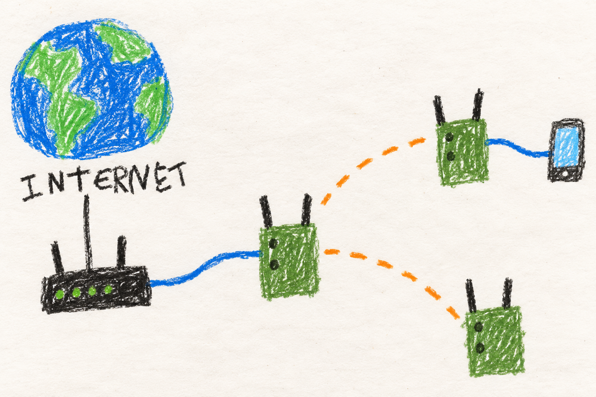

# Share an internet connection

## Marine

### One way out can help the others

1. Give one radio a working internet connection.
2. Let the radios connect to each other.
3. Your friends can all download internet pictures through this shared connection.

No internet? The radios can still talk to each other. If the way out changes,
you may have to start your RedTube download again.

A radio can also borrow house Wi-Fi. That uses one of its built-in radios.
Open **Manage → Uplink**, scan, and tap the network's name. A lock means it
needs a password. Scroll the list to see more names.
A key and **Saved** mean this radio remembers the password. Tap the name,
then **Connect**. The password stays on this radio.
**Forget** removes a remembered password. It does not stop the connection.
The radios hide their own phone hotspots from this list.
If scanning needs to stop phone
Wi-Fi, the page asks first. Reconnect to see the saved list. 

Turn off borrowed Wi-Fi when you do not need it. Its helper then stops.

A working internet cable wins over house Wi-Fi. If that cable stops working,
the radio can use Wi-Fi again. Give it a few seconds, then try again if your
picture stops loading.

## User

### Internet and mesh are different connections

The mesh connects nearby radios to one another. An **uplink** connects a
radio to the internet. A radio sharing an uplink becomes a **gateway** for
the mesh. Local voice and local mesh services do not need an internet
connection once the radios are set up.

You can provide an uplink through a supported Ethernet connection, USB
tether/modem, or one of its built-in Wi-Fi radios. Ethernet detects whether a router offers
network settings. The radio then checks whether the connection actually
reaches the internet: an HTTP request that must come back with a 204 answer.
A sign-in page fails that check. A router being present does not guarantee
that its internet service is working.

When this radio has several working internet connections, it prefers wired
Ethernet, including a supported USB Ethernet adapter. A USB phone tether or
cellular modem comes next. Built-in Wi-Fi connections come last.
A cable serving your phone or computer as a wired client is excluded.
The current connection stays selected among working connections of the same
kind. Wi-Fi can stay connected while Ethernet carries the internet traffic.
If Ethernet fails, the radio tries its other connections. When Ethernet
passes its internet check again, it becomes preferred again. These switches
can interrupt a download or call.

If Wi-Fi is already joined and working, cable unplug/replug should usually
settle within a few seconds after the radio checks the new connection.
It starts using the connection before measuring its speed. Getting a new
network address, an unresponsive router, or a hotspot channel change can take
longer. The phone keeps its local address during a normal uplink switch.
If an existing download or call stalls after internet returns, restart it.
If the router still looks connected but its internet service changes, the
radio's regular gateway check runs about once a minute. A slow connectivity
probe or busy service can add time before the change is applied.

### Use nearby Wi-Fi

Open **Manage → Uplink** on the node
that should connect. Choose an available built-in 2.4 GHz or 5 GHz radio,
then press **Scan**. Tap a network in the list. Stronger signals come first.
Scroll to see more names. Each row shows signal bars, the Wi-Fi band, and a
lock for a secured network. Grey rows explain why they cannot be selected.
Hidden networks stay visible but cannot be selected because their names are
not broadcast.

The list omits phone hotspots with this radio's configured hotspot name and
four lowercase digits or letters from a to f, such as **EUD-5cc2**. They lead
back into the mesh and cannot supply a Wi-Fi uplink. Typing the name also
fails. An older saved match is disconnected, and status explains why. Choose
a house router or another independent internet connection. Radios using a
different hotspot name are outside this name-based check.

After choosing a network, enter its password and press **Connect**. Open
networks do not show a password field. Built-in radios support WPA2 and WPA3
personal passwords. Passwords stay on
this node and are separate from the mesh key and your phone hotspot password.

Once the radio joins a secured network, it remembers the working password.
That network shows a key and **Saved** in the list. Choose it and press
**Connect** to use the saved password. Choose **Use a different password**
if the router's password has changed. A password that fails to connect does
not replace the saved one. A password saved for WPA2 is separate from one
saved for WPA3, even when the network name is the same.

The **Saved networks** list shows the names and security types remembered
on this node. Both built-in radios share that list. **Forget** removes
the saved copy without disconnecting a connection already in use. The next
time you choose that network, enter its password again. This radio remembers
up to 32 networks and drops the one unused longest when it needs room.
It does not pick a different saved network automatically when you move.

When built-in Wi-Fi uplink is disabled, its helper stops after restoring the
normal radio roles. Saving an enabled connection or rebooting with one saved
starts it again. Normal channel changes and connection loss wake the helper
as they happen.

The current network appears at the top with its connection state. **Joined
Wi-Fi, waiting for a network address** means the nearby router has not yet
assigned an address. **Connected, sharing internet** means this connection
is the selected local internet path. A Wi-Fi connection can stay joined while
a cable carries internet instead. Try an internet application to confirm the
full path works. Use **Rescan** to refresh the list. After five minutes, scan
again before connecting. Changing radios clears the previous selection.

With a wired client connection, either built-in band can supply the uplink.
That band leaves the mesh. With a Wi-Fi client connection and a 2.4 GHz
uplink, only HaLow carries mesh traffic, so expect lower speed. With a 5 GHz
uplink, this node's own Wi-Fi hotspot shares the radio and follows the house
network's channel. Other nodes keep their agreed mesh channels.

A shared hotspot with a working house connection normally stays up during a
scan. When the hotspot must stop, the page asks first and warns of about
15 seconds without Wi-Fi. Reconnect and the saved list appears with its age.
If mesh restoration needs another try, a separate warning appears. The scan
results are still available. Mesh scans briefly interrupt that mesh band.

Networks marked **DFS** use
channels where the upstream router watches for radar. With DFS follower
support installed, this node joins that router first, then starts its shared
hotspot on the same channel without another radar wait. Losing the house
connection pauses the hotspot until the connection returns. A house-router
channel move also pauses and restarts it, so your phone may need to reconnect.

Without that support, a DFS upstream keeps this node's shared hotspot off.
Status explains why. Use Ethernet or another node for access, or select a
non-DFS house network. Repeated hotspot startup failures also leave it off.
Reconnect the uplink to retry after correcting the problem. A separate
hotspot on another radio is unaffected.
**Disconnect** releases the uplink
radio back to its normal mesh or hotspot role. Disconnect it before changing
the EUD mode setting. A wrong password leaves it
trying to connect until corrected or disconnected.

Disconnect remains available while mesh channel agreement is in progress.

### Recognize a working path

Look at gateway and route information on the [dashboard](dashboard.md).
Then try the application you actually need. A working local dashboard
proves that your device can reach its radio. It does not prove that the
mesh has internet. A network with a sign-in page may also provide an address
while failing the radio's internet check.

More than one radio can offer internet. MANET considers both the path across
the mesh and the advertised uplink capacity. It avoids changing gateways
for small, brief improvements. If the current path fails, it can select an
available replacement. If a radio's own Ethernet uplink stops working, it
tries its other local internet connections. If none works, it stops being a
gateway and can use another gateway on the mesh.

A gateway change can break an existing download, call, or other internet
session because traffic now leaves through a different connection. Reconnect
the application after the new route settles. No replacement is possible if
none of the reachable radios has a working uplink.

### Reach the mesh from your own network

A gateway normally hides the mesh behind its own internet address, so devices
on the internet side cannot start a connection to a radio. To reach the radios
from a private network, such as a ZeroTier network your router belongs to,
set `uplink_routed` to that network on the radios. Only the gateway uses it,
so the same setting can go on every radio. Your router also needs a route for
the mesh network via the gateway radio. Give the gateway radio a fixed address
on the router so the route stays valid. The mesh network can be part of the
private network's range. Ranges wider than a /8 are ignored, so a mistake
cannot switch off address translation for the whole internet.

Devices on that network can then reach radios and the devices connected to
them by their mesh addresses, for SSH, ATAK, voice and video. Each radio's web
page still only answers its own connected devices. The
[additional scripts guide](../../../MANET/provisioning/additional-scripts/README.md)
includes an example that sets it.

### Speed and data use

A fast router cannot make a slow mesh path faster. Several hops, shared
radio airtime, and other users can all limit the result. The displayed
uplink figure is also different from an end-to-end speed test on your phone.

Wired Ethernet uplinks use a small download to estimate available capacity.
The connection can carry traffic before the download finishes. The download
only sets the advertised figure. A slow or filtered connection
still counts as internet. It is advertised as slow, not dropped.
Phone tethers, cellular interfaces, and Wi-Fi uplinks use an assumed capacity
instead of that download test. Internet use by connected people still uses
the upstream connection's data allowance.

## Developer

### Local client and shared hotspot

The Uplink picker scans built-in radios. Before storing or
grouping observations, it removes exact matches of the current local
`lan_ap_ssid` plus `-` and four lowercase hexadecimal characters. The prefix
is fixed at flash time, literal, and case-sensitive. Use the same base name
on all radios in a mesh. Other prefixes, uppercase suffixes, and suffixes
of another length remain visible. This includes this node's own hotspot seen
from another radio. It is a naming rule, not proof of mesh membership.

The server rejects matching typed and scanned connection requests. The
built-in watcher persists disabled intent and restores the normal radio roles
for a previously saved match. Gateway qualification checks saved names before probing,
so watcher timing cannot promote a matching profile. Status gives a plain
reason. The shared AP follower owns startup after station association, while
the dispatcher only starts its supporting services once hostapd is active.

The picker groups matching
SSID bytes by band, security, DFS status, and availability, using the strongest
BSSID in each group. Hidden names remain separate by BSSID. Different bands,
security methods, and radar-channel choices stay separate. The connected group
appears once at the top. A selection pins its BSSID on either built-in radio.
Names are escaped as text for rendering. Valid UTF-8 bytes from `iw` display
as characters, including emoji. Invalid UTF-8 and control bytes stay visible
as escapes with a disabled-row explanation.

The helper rejects menu selections outside its five-minute scan window
or from a different interface. Credentials travel in the local POST body
and helper stdin, never through mesh coordination.

`manet_wifi_saved.py` owns `/etc/manet/wifi-uplink-saved.json`, a root-only
`0600` credential store shared by the built-in radios. Entries use exact UTF-8
SSID bytes and security as their key. The store retains the 32 most recently
used networks, updating order only after successful association and protecting
the enabled profiles from eviction. A separate
private lock serializes migration, observation, and forgetting. Writes replace
the file atomically and fsync both the contents and its directory.

The first read imports the existing built-in profile. New requests
put a random attempt ID in the private profile and supplicant `id_str`.
The built-in follower saves credentials only after supplicant reports `COMPLETED` for that
attempt and the selected BSSID. Service startup alone is insufficient.
A stale observation cannot validate a replacement profile. Failed passwords
leave any saved copy intact. DHCP and internet qualification are separate
from this authentication check.

Scan responses expose only a `saved` boolean. Saved-network lists expose
only names and security. A local `use_saved: true` request resolves the
password on the radio by SSID and security, refusing absent entries before
changing roles. The authenticated Forget POST removes the saved entry without
changing the active profile. It also cancels a pending save for that network
for the active built-in client. Completed attempt IDs prevent later observations
or reboot from restoring a forgotten entry. A new explicit connection can
save it again after successful authentication. No saved-network auto-join
policy runs, and the store stays outside config push, Alfred and telemetry.

The private client profile reserves one MT7916 PHY. Active mesh and band roles
are withdrawn under the same lock used by ACS and drift repair. A dedicated
supplicant owns wlan0 or wlan1. A shared 5 GHz EUD AP uses `manetap`, so AP
preparation cannot change the station into a mesh interface. Client DHCP and
NAT reuse the existing gateway path without bridging the upstream to br0.

The networkd files and ownership marker are readable as soon as they are
published. Client credentials remain private. The shared AP uses a stable,
locally administered unicast address derived from its PHY, avoiding the
station, br0, bat0, and other local interface addresses. Disconnect restores
the static channel, existing ACS commitment, or recovery anchor under the
channel lock, even during agreement, without starting a new round.

The follower waits for supplicant association/channel events, hostapd events,
link/address changes, and local policy changes. Service lifecycle notifications
and socket replacement also wake it. It prefers hostapd CSA on non-DFS changes,
verifies completion, and restarts the AP if necessary. A missing completion,
busy lock, or pending restore gets a three-second retry. Disassociation stops
the shared AP before requesting station reconnection. With no enabled profile
or repair work it exits, leaving a systemd path unit to wake it on demand.
An enabled profile has a 120-second safety reconcile for missed events,
including silent control failures. It calls the uplink dispatcher only when
the observed policy changes. Node-manager's existing 60-second gateway check
covers internet reachability changes without local events. Notifications and
scan repair live under `/run/manet-wifi-uplink/`, and the gateway marker lives
at `/run/manet-uplink/mesh-gateway.state`. Input and control-socket directories
are watched directly, so unrelated `/run` activity leaves the follower asleep.

DFS sharing requires the matched kernel and hostapd follower support. The
controller checks the loaded kernel option and hostapd version. It starts the
station first and requests a 20 MHz follower AP only on the station's live
channel. The kernel checks the ordinary BSS station association again under
its lock. It admits the explicit follower without local radar detection or
CAC, so scanning is not blocked by a radar-required AP. Ordinary AP starts
keep their normal DFS behavior. Regulatory flags remain unchanged.

The kernel tracks follower permission separately from channel availability.
It stops the follower on supporting-station loss, even if the channel is
marked available. At upstream CSA start it stops the AP and blocks follower
starts during the countdown. After the station moves, the watcher restarts
the hotspot on the new channel. Radar at the upstream master is handled by
that master's CSA or subsequent loss of association.

Without both pieces of support, DFS retains the hotspot-off fallback and a
plain status reason. The uplink's association, address, and gateway status
remain independent. Stale status cannot authorize an AP start. Three failed
starts or any unexpected CAC latch the hotspot off until an observed loss
and reconnect or a channel change. Radar-unavailable channels stay blocked.
The usual AP-only PHY power cap is skipped while sharing. Associated shared
APs scan in place when non-DFS or operating as supported DFS followers.
Other serving-AP scans require preflight confirmation and a locked recheck.
Scans save results before restoration. Status exposes their boot-clock age.
The watcher retries failed restoration separately from client state. Mesh
restoration uses live starting MHz or the agreed/static channel and updates
the supplicant file. Dispatcher AP starts share the same role lock. See the
[ownership and recovery reference](../../../docs/node-tools-internals.md#built-in-wi-fi-uplink-ownership).

### Role changes reconcile the whole forwarding path

An Ethernet DHCP response classifies a possible upstream network. It is
not the final internet verdict. The active dispatcher reconciles interface
role, bridge membership, local addressing, route/NAT policy, and BATMAN
gateway advertisement. Client-facing Ethernet belongs to `br0`. An upstream
LAN must not remain bridged into the client mesh after promotion. USB
Ethernet hotplug handlers feed the corresponding uplink lifecycle.

Gateway status also affects Auto EUD/AP policy, so loss of an uplink can
change whether the candidate Wi-Fi interface serves clients or mesh peers.
These are related transitions, not independent scripts choosing permanent
roles. See [Ethernet role ownership](../../../MANET/networkd-dispatcher/README.md)
and [client connections](connect.md).

The gateway masquerades its uplink except for networks listed in
`uplink_routed`. The firewall rebuild on every promotion adds a NAT exemption
ahead of the masquerade rule and a forward accept from the uplink into `br0`
for each one. They are not standalone rules because the rebuild flushes both
chains and the forward policy drops. See the
[uplink internals](../../../docs/node-tools-internals.md#gateway-choice-and-uplink-speed).

### Selecting a Linux default route

The local uplink dispatcher excludes wired EUD bridge ports, then ranks
Ethernet ahead of supported USB tether/cellular links, with Wi-Fi clients
last. It reuses the bandwidth helper's Ethernet classification, including
its conservative phone/modem driver exclusions. Within each class it tries
the saved promoted interface, current route, event interface, other defaults,
and discovered devices. Each must still pass carrier, address, and internet
checks. Reconciliation can replace working Wi-Fi with qualified Ethernet.
Wi-Fi events cannot take the route from working Ethernet. Loss tries the
remaining candidates in the same pass. This local policy has no speed-based
improvement timer. The Wi-Fi follower requests that same reconciliation on
connection/address and AP-policy changes. A quiet 120-second safety pass adds
no dispatcher call. The node manager continues to requalify internet access
at its existing 60-second gateway interval.
The packaged Ethernet unplug hook requests reconciliation under its held
policy lock before slow cleanup, without waiting for that tick. Ready local
fallbacks are probed before demotion. An unaddressed standby is skipped on
this loss pass, so DHCP cannot delay an already-ready Wi-Fi path. The gateway
marker stays present across a successful local handoff, preventing a temporary
mesh default. With no qualified ready fallback, remote mesh routing is the
useful interim path. Ethernet detection always targets the physical event
interface, never the saved Wi-Fi uplink, and rejects wireless devices.

Each switch updates the metric-100 route, NAT, selected DNS, and BATMAN
bandwidth. Wi-Fi receives its own estimate, with the HaLow cap when needed,
even if the preceding Ethernet estimate was higher. The mesh route manager
defers to the selected local uplink regardless of its interface class.
DNS follows the qualified resolver file without restarting dnsmasq. Identical
EUD configuration preserves the DHCP process and leases. A changed pool or
main configuration can require one restart. An optional, narrowly filtered
conntrack deletion removes old-address NAT mappings after switching, but does
not preserve established sessions or guarantee a TCP reset. Healthy ready-link
handoffs take a few seconds. Probe failures, DHCP, and AP-role transitions can
take longer.

BATMAN's gateway selection steers its DHCP behavior. It does not by itself
install the Linux default route required here. The route manager evaluates
the advertised gateways and scores each as the smaller of its BATMAN path
throughput and advertised download bandwidth. A 100 Mbit/s uplink reached
over a 6 Mbit/s path scores 6. A 20 Mbit/s uplink reached over a 40 Mbit/s
path scores 20.

A voluntary replacement must be at least 1.5 times the current score and
at least 2 Mbit/s better, continuously for sixty seconds. A five-minute
hold after a switch limits churn, including after the first selection.
The current gateway disappearing, or failing two consecutive reachability
checks, permits replacement without waiting for an improvement interval.
An existing `br0` default route identifies the incumbent after a controller
restart. Only a metric-100 default route on the selected uplink interface is
preserved. A promoted direct uplink uses metric 100, the mesh route 500, and
networkd's own DHCP default 1024, which never wins.

This hysteresis trades some instantaneous performance for session stability:
a new egress gateway can change the NAT/public address and break transport
connections. These figures are selection policy, not a failover latency
guarantee under every service scheduling or link condition.

### Advertised capacity and name resolution

Ethernet qualification is the HTTP 204 check. A separate 5 MB HTTPS download
then estimates capacity in a separate systemd worker after forwarding is
installed. Ethernet starts with unknown bandwidth until a matching result is
available. Before publishing or announcing, the worker rechecks the selected
promotion, address, router, and carrier generation under the policy lock.
A download completing after a switch cannot overwrite Wi-Fi's announcement.
The measurement excludes DNS/TCP/TLS setup and
divides bytes by transfer time after the first byte. A partial transfer of at
least 250 kB counts. TCP startup can still under-read a fast connection, and a
link with no usable measurement is advertised as 1 Mbit/s down and 0.2 up. The result is reused
while the interface, address, router, and carrier generation remain the same. Demotion invalidates
it. Failed tests are rate-limited rather than repeated each loop.

Recognized tether/cellular drivers and Wi-Fi uplinks avoid that download
and start from 10/2 Mbit/s after their connectivity probe. If HaLow is the
only active mesh radio, both directions are capped at 1 Mbit/s without raising
a lower upstream estimate. This is a conservative estimate, not a measured
HaLow rate. For measured wired
uplinks, upload is an assumed fifth of download, not an upload test. Selection
uses download. Consequently these advertisements are bounded inputs to a
route heuristic, not a promise of symmetric throughput.

DNS follows qualification. A promoted uplink's DHCP resolvers become the
node's resolvers. An unqualified or demoted Ethernet lease never supplies DNS,
so the node resolves through the public fallback over the mesh. A lone node on
a LAN that only allows its own resolver qualifies with a lookup bound to that
link, then uses that resolver once promoted. Local forwarding avoids a
localhost loop. Gateway selection does not replicate an upstream
router's private DNS namespace across every radio. If IP connectivity works
but a private hostname fails, investigate DNS separately from the mesh route.
The [gateway and speed reference](../../../docs/node-tools-internals.md#gateway-choice-and-uplink-speed)
contains the measurement lifecycle and implementation links.
