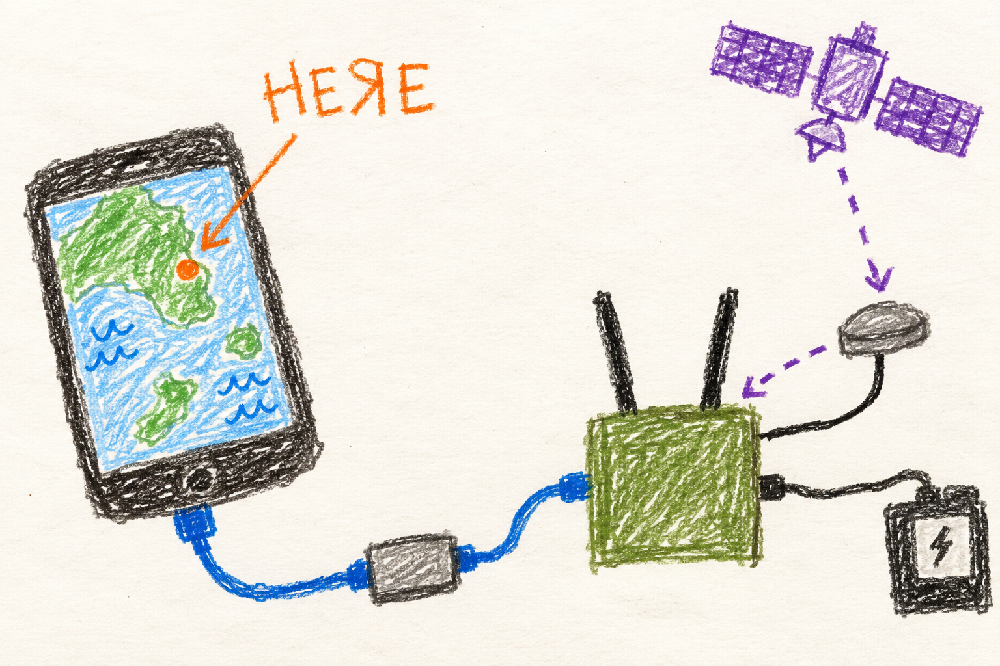

# Location and ATAK

## Marine

### Show the phone where you are

Plug your ATAK phone into the radio with its Ethernet adapter, or join that
radio's Wi-Fi. Stay near the radio. Give its GPS receiver a chance to find you.

Several phones? One sets the group's location. Open [manet.local](http://manet.local/)
and look under **ATAK PHONES**. Choose a phone there; no admin password is needed.

The phone needs the right ATAK settings to use the radio's position.
No good position? A dot on an old map is not proof of where you are now.

## User

### Set up your ATAK phone

ATAK is a mapping application that can receive information from the radio.
Use a **wired Ethernet connection** or this radio's enabled **Wi-Fi access point**.
Several nearby phones can use one radio. They all receive the same radio position,
so stay near the radio and coordinate who sets the group's location.

1. Connect the phone through a compatible Ethernet adapter to the radio's
   client Ethernet connection, or join this radio's own Wi-Fi network.
2. Turn off Android location services for this setup.
3. Configure ATAK to receive external GPS CoT on **UDP 4349** and ordinary
   CoT on **UDP 4242**. CoT is the message format ATAK uses for these events.
4. Configure ATAK's situational-awareness output to the radio's IPv4 address
   on **UDP 4242**. That traffic lets the radio associate the attached phone.
5. Look for the contact **MANET mesh-XXXX**, using the radio's actual hostname.
   To send a manual point to the radio, select this contact with ATAK's Send
   action. Its Send endpoint uses **TCP 4242**.

The contact itself is hidden from the map. A separate external-position
feed supplies location, so absence of a contact marker does not prove that
the contact is missing. A custom `atak_callsign` can change its name.

### Choose who sets the group's location

Open **[manet.local](http://manet.local/)** and expand this radio. The **ATAK PHONES**
panel shows each present phone's callsign, **Wired** or **Wi-Fi**, and which one
**Controls location**. Tap **Set location from this phone** beside another phone
if you want it to control. No admin password is required. Wait for the list to
refresh and show the new controller.

Your saved choice wins while that phone is present. Otherwise, the only wired
phone wins. If there is no sole wired phone, the current controller keeps control
while present; if it has left, the radio randomly chooses a present phone and
keeps it. A phone can remain present for up to 75 seconds after its last position
report. Your saved preference survives a reboot or departure and takes priority
when that phone returns.

Only the controller's sent points, drags and manual location selections can set
the radio's location. Switching controllers does not erase a held manual point.
Other phones receive the position and GPS warnings. Sending a point from a guest
phone produces a chat naming the controller and explaining how to change it.
When another phone joins or control changes, every present phone gets a chat
naming the controller. Agree with the group before changing it.

### Understand the position you are using

A connected GPS receiver still needs a fresh fix. Indoors, blocked sky or
receiver trouble can leave it without one. A manual point is a supplied
location, not a fresh satellite measurement; check its age and the displayed
source before treating it as your current position.

The radio sends no CoT until a phone is admitted. If nothing appears, check
the cable or local Wi-Fi connection, the phone's address and the ATAK settings before
assuming GPS is broken. A healthy mesh between radios does not establish
the phone's local connection.

The project also contains experimental radio-ranging and position-estimation
work. It is disabled by default and is not a ready replacement for GPS.
Do not assume that seeing neighboring radios means MANET can determine your
position from them. The radio's [clock synchronization](time.md) is a
separate function.

## Developer

### Admission is a local network proof

The ATAK daemon is enabled by default; an absent/empty `atak` setting means
enabled, while `n`, `no`, `0` or `false` disables it. The current path requires
an independently verified local EUD port: wired `end0`, or the active AP named
by `/var/lib/ap_interface`. The AP requires live hostapd identity, matching
configuration, carrier and forwarding br0 membership. Routed Ethernet does not
prevent AP admission. A resolved br0 neighbor's MAC must be learned exclusively
on one admitted local port, never also bat0. Each new TCP stream or UDP peer
requires a fresh proof.

The bridge firewall allows only the configured local interface names for service
traffic on 4242/4349; strict readback rejects altered rules. AP renaming requires
an ATAK service restart to replace the allow-list. AP role/config metadata and
hostapd PID/start identity invalidate cached proof without subprocess polling.
SA leases, clocks and UID/IP/MAC/attachment records are bounded by the provisioned
`max_euds_per_node` (0–253, zero meaning one wired-primary phone). Missing/invalid
values log and use eight; absent rows can be evicted when the table is full.

The daemon subscribes to route/link/address/neighbor/FDB and nftables events
before its initial snapshot. Unchanged ticks reuse a cached proof, avoiding
repeated `ip`, `bridge` and `nft` subprocesses. Events during a snapshot
invalidate it; subscription failure, overflow or truncation ends the process
so systemd can establish fresh subscriptions. The kernel policy remains
the packet boundary: userspace notifications do not make an arbitrary
external firewall flush atomic with I/O.

### Inputs, output and retained state

GPS data comes through gpsd and the local reader, with per-receiver epochs
and freshness. Replayed epochs cannot keep a fix alive merely by arriving
again. The GNSS reader tracks signal/time anomalies as hints; these are
not proof of spoofing. In particular, an unavailable receiver diagnostic
must stay unknown rather than become a clean bill of health.

The ATAK selection logic combines admitted-phone state, fresh location
inputs, manual points and available monitoring information. Phone presence,
phone clock information, manual controller preference and radio manual-location
state persist under `/var/lib/manet-atak`. Schema 2 explicitly discards old
schema-1 single-pin state; checksum failures and unknown schemas still stop
startup. The daemon never sets the OS clock. Every present phone gets contact
and external position in its own clock domain. Only controller gestures and
read receipts can acknowledge the radio's warnings; guest receipts cannot.

Controller preference is manual-if-present, sole wired, current-if-present,
then stable random. A boot/session-bound JSON producer file carries the local
web choice to the existing event cycle, which rechecks the selected phone's
presence and path. The overview exposes only ATAK enable/running state and
phone UID, callsign, port and controller status; session identity and the full
runtime snapshot stay server-side. The HTTP POST requires JSON, rejects foreign
origins and checks this radio's DHCP source pool. The port-80 `manet_ui` firewall enforces
that same local pool plus loopback; it assumes a trusted team network rather
than proving physical HTTP ingress. The held location and distrust survive
controller switches, and marker deletions still target the original phone.
This source change has offline coverage; CM4 AP and multiple-phone validation
is still pending.

With no admitted phone, no CoT is emitted. Before the first association,
the application skips GPS selection and unchanged state serialization while
still tracking monitoring-input freshness and producer loss. With no live SA
lease, network events discard proof without launching snapshot commands.
Passive br0 listeners use a cheap address ioctl; the next new peer or TCP
stream must pass full firewall/path readback before application admission.
Pending verification makes `path_ready` false, with no timer-driven refresh.
After a phone leaves, retained manual points and warning history still need expiry and
durable age handling. A runtime status file is the last snapshot, not a
heartbeat; an unchanged timestamp during idle does not mean the service died.
See [ATAK lifecycle and freshness](../../../docs/node-tools-internals.md#atak-runtime-and-package-defaults).

### Experimental ranging has an explicit hardware boundary

The positioning code separates ranging messages/scheduling, the radio
adapter, a position solver and GNSS-versus-range consistency checks. The
solver uses acquisition-time observations and uncertainty models; repeated
frames do not remove a shared radio boot-offset error. A range-consistent
solution is not proof that satellite signals are authentic: jointly
displaced positions can preserve relative geometry.

The supplied simulation exercises service objects without opening live radio
sockets. The production helper boundary is unavailable until authorization,
mesh-port ingress proof, scoped probes, watchdog behavior and capture
capabilities are provided and verified. `manet-positioning.service` remains
disabled and `positioning` defaults off. Enabling a flag alone does not
complete those dependencies.

For the actual boundaries, read the module descriptions in
[the positioning controller](../../../MANET/node_tools/manet-positioning.py),
[radio adapter](../../../MANET/node_tools/manet_ranging_radio.py),
[solver](../../../MANET/node_tools/manet_locate.py) and
[consistency monitor](../../../MANET/node_tools/manet_spoof.py).
The [tool map](../../node-tools-map.md#location-and-experimental-positioning)
lists the related files. Kernel timing experiments should be evaluated
against their recorded hardware evidence, separately from this user feature.
