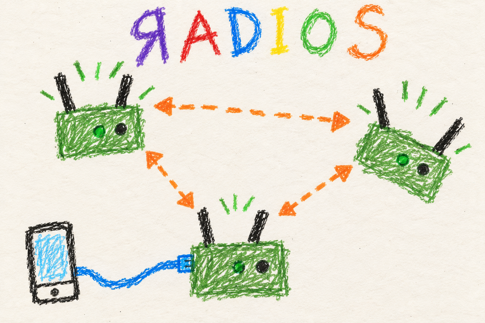

# Meet the mesh

## Marine

### Radios talk to radios

Your phone connects to your radio. Your radio finds other radios and passes along traffic for other friends in the mesh. Radios do not taste good.

- **Same mesh settings.** Set all the radios up with the same settings.
- **Power them on.** Nearby radios find each other.
- **Internet is extra.** The mesh can work without it. A radio with internet can share it with other friends.

New radio? Start with [flashing](flash.md).

## User

### What MANET does

MANET turns supported single-board computers into mesh radios. Nodes form links with nearby peers and carry traffic across multiple hops. Each node manages addresses for its connected phones and computers.

Conventional Wi-Fi provides the faster links. HaLow uses a lower radio band and is intended for longer reach at lower speed. Actual range and throughput depend on the hardware, antennas, placement, and surroundings.

Radios coordinate channels, recover connections, and elect hosts for shared services. A node with internet access can act as a gateway for the mesh. Internet access is needed for initial provisioning; an already provisioned mesh can operate without it.

### Why addresses are automatic

Every radio and connected device needs a network address so messages reach
the right destination. Each radio listens for addresses the others are
using, then chooses a small group for itself and its connected devices.
You do not need a central router handing out all of the mesh's addresses.

Radios starting together, or groups meeting after being separated, can
temporarily choose overlapping addresses. They detect that overlap and
decide which radio must choose again. That can briefly interrupt a connected
device; its connection may need to renew before traffic resumes. A short
startup wait gives radios time to hear one another before choosing.

See [addresses and names](addresses.md) for client capacity, local names
and what to do after an address changes.

### Start with a CM4

The Compute Module 4 is the primary verification target. Raspberry Pi 5 and Rock 3A are supported, with different hardware and thermal considerations. Check the [hardware table](../../../README.md#supported-hardware) and [radio hardware requirements](../../../MANET/provisioning/README.md#radio-hardware) before buying or assembling a node.

1. [Flash a radio](flash.md) with the settings for your mesh.
2. [Complete first boot](first-boot.md) using Ethernet internet access.
3. [Connect your device](connect.md) and open the local dashboard.

### Once the radios are running

- [Read the dashboard](dashboard.md) to inspect peers and measure a path.
- [Use voice](voice.md), [connect ATAK](location.md), or use [shared services](services.md).
- [Share internet](internet.md) and understand [time sources](time.md).
- [Measure a connection](measurements.md) and manage [saved results and logs](storage.md).
- [Change settings](settings.md) with the local and mesh scopes in mind.
- [Read power indications and shut down](power.md).
- [Update a radio](updates.md) when a tools release is ready.
- [Troubleshoot a problem](troubleshooting.md) from the symptom you can see.

[What runs automatically](automation.md) connects the background jobs to
these results. Builders can also read [hardware](hardware.md),
[custom setup](customization.md) and [development](development.md).

### What is still developing

This guide describes the current source tree. Normal installation selects the stable release marked **Latest**, which can lag behind source changes. Use `--development` explicitly when testing newer published builds.

ATAK integration and experimental radio-ranging work are separate features. ATAK runs by default; ranging-based positioning is disabled by default and should not be assumed to provide a working location solution.

## Developer

### Runtime architecture

MANET is a Debian 13 appliance stack. Its forwarding plane is `batman-adv`
using BATMAN V: conventional Wi-Fi mesh and Morse Micro 802.11ah HaLow
interfaces become underlying links of the virtual `bat0` interface. BATMAN
chooses paths through that Layer 2 domain. The addressed bridge, `br0`, joins
`bat0` with the node's local end-user-device (EUD) connection. Client traffic
can therefore cross several radio hops without a separate IP subnet for
every hop.

The management plane runs alongside forwarding. Alfred distributes identity,
telemetry, and control records; each node builds its own local view of the
mesh. The orchestrator uses that view for address management, channel work,
and service elections. A service host or channel coordinator is elected for
a purpose, rather than acting as a permanent controller for all traffic.
An ordinary forwarding path does not depend on the web server.

### How a node learns about its peers

Alfred exchanges records over `br0`, using IPv6 link-local connectivity before
the node has selected an IPv4 block. Identity records describe relatively
stable properties such as interface MACs, hostname, and allocation; separate
telemetry records carry changing observations. Their common Alfred publisher
MAC joins the two into a registry entry. BATMAN originators provide the
current reachable membership, while the registry supplies the corresponding
identity and measurements.

Those sources answer different questions. A cached registry entry does not
prove a peer is reachable now. Re-reading an unchanged telemetry record does
not make it fresh: the receiver ages observations using its own boot clock.
That avoids depending on another node's possibly incorrect wall clock during
startup. [Registry construction and freshness](../../../docs/node-tools-internals.md#data-management)
explains publication intervals, caching, and stale-record removal.

### Addresses: selecting a block and resolving collisions

Every radio allocates a contiguous block from the shared IPv4 network. The
block width is the provisioned client capacity plus two addresses: one for
the radio's mesh identity and one for its local client gateway. Both are
assigned to `br0`; the remainder is that radio's DHCP pool. The first five
usable addresses in the network are reserved for shared services.

For example, in `10.30.0.0/24` with one client per radio, a block contains
three addresses. There are 254 usable addresses, minus five reserved, so
83 complete blocks fit:

| Chunk index | Radio's mesh address | Local client gateway | Client address |
|---|---|---|---|
| 0 | `10.30.0.6` | `10.30.0.7` | `10.30.0.8` |
| 1 | `10.30.0.9` | `10.30.0.10` | `10.30.0.11` |
| 2 | `10.30.0.12` | `10.30.0.13` | `10.30.0.14` |

There is no central allocation server. Each node advertises its chunk index,
primary address, and block width in its Alfred identity. Before claiming a
block, a new node waits for usable local IPv6, Alfred readiness, and its own
published identity/telemetry. It then observes one 10-second Alfred
synchronization period. If visible peers still lack records, it waits up to
20 seconds from that observation window's original start. It continues
publishing during the wait, so a group starting together can discover itself.
A failed local query defers allocation; it is not interpreted as an empty mesh.

The allocator excludes every candidate whose **address range** overlaps a
known peer claim. Range comparisons matter because nodes may have different
client capacities: a five-address block can overlap two three-address blocks
even when their chunk indices or primary addresses differ. A remembered block
is reused only if the current observations leave it free; otherwise the node
picks randomly from the remaining candidates and publishes its claim.

This avoids known conflicts, but two nodes can still choose the same free
space before either hears the other's announcement. Disconnected partitions
can also reuse space. On later reconciliation, an overlap is resolved by a
deterministic MAC comparison: the higher MAC keeps its block, and the lower
MAC releases its addresses and chooses again. Random selection reduces
simultaneous collisions; observation and this tie-break provide repair.
It is not a guarantee that addresses never collide or that recovery is
instantaneous. Client connections can be interrupted when a block changes.

The [allocation and collision-recovery reference](../../../docs/node-tools-internals.md#ipv4-allocation-and-collision-recovery)
gives the exact address calculation, mixed-width example, startup conditions,
claim expiry, persistent state, and implementation links.

### Routing, channels, and shared services

Routing chooses a path over existing links. Channel selection changes which
Wi-Fi links can exist, so it requires coordination. With ACS enabled, a
coordinator proposes a band plan to the whole reachable BATMAN component,
including nodes connected through HaLow. Participants validate it and vote;
a strict majority of the frozen membership permits a scheduled activation.
Radios only look at other channels when one of them reports lasting
interference on its current channel, and a preference move needs the better
channel to win three rounds in a row.
Using one membership view avoids independently moving two Wi-Fi groups that
are still connected by another radio path. Lost final messages and partition
changes still require authenticated recovery. See
[channel agreement and rejoining](mesh.md#developer-one-connected-component-one-channel-decision).

Service elections solve a different problem: which node should host a shared
service. Candidates are ranked using their mean BATMAN throughput metric,
with deterministic ties and incumbent handling. Services such as MediaMTX
and Mumble use reserved virtual addresses, so clients can keep a service
address when the host changes. Separate partitions may each elect a host;
reconciliation releases a losing host and its virtual address after rejoining.
The virtual address does not preserve an interrupted application session.
[Service election details](../../../docs/node-tools-internals.md#service-elections)
describe the eligibility and scheduling rules.

### Client access, administration, and voice

Bridging provides reachability but does not establish access boundaries.
Local DHCP and discovery traffic are kept off the mesh so clients use their
attached radio's address pool and management name. The web firewall uses
the local pool's source addresses because both local clients and remote
mesh traffic can arrive through `br0`.
[Client traffic and isolation](connect.md#developer-layer-2-topology-and-address-ownership)
explains this boundary.

Administrative changes use a separate authenticated, encrypted Alfred
protocol. The shared admin password authorizes them; public identity and
telemetry do not. A staged change collects authenticated acknowledgements
and has a scheduled activation. Persistent replay history prevents old
commands from being applied again after a restart, while local rollback can
restore connectivity after a dangerous change.
[Settings transactions](settings.md#developer-transaction-authority-and-lifecycle)
describes the sequence and its limits.

Voice uses multicast RTP with Lyra by default. A talk group selects an RTP
port pair; receivers create separate jitter/decode paths for each speaker
and mix the decoded audio. Physical PTT gates microphone transmission on the
radio. Codec agreement, multicast membership, and a working mesh path are
all required; the browser does not carry the audio.
[Voice transport](voice.md#developer-pipeline-and-transport) explains the pipeline and
how it handles multiple speakers and restarts.

### Authority and boundaries

Current implementation and focused verification establish behavior. Historical handoffs record useful rationale, but old bench results and pending-work notes do not establish current support. The feature roadmap also needs interpretation against the implementation.

### Build and release boundaries

Normal provisioning and updates follow the full GitHub release marked Latest. Development selection is explicit. Publishing uses `MANET/releases/publish.py`, which stages assets, verifies their stored sizes and digests, and publishes the complete set. A source push does not announce a radio update.

Kernel builds and package builders are maintained outside the tracked source layout. Do not infer that a clean repository checkout can reproduce those machine-local build environments without the documented prerequisites.

### Detailed references

- [Runtime ownership and background work](automation.md)
- [Node-tool map by responsibility](../../node-tools-map.md)
- [Build and release workflow](development.md)
- [Runtime and configuration reference](../../../MANET/node_tools/README.md)
- [Runtime internals](../../../docs/node-tools-internals.md)
- [Kernel, Morse driver, and build chain](../../../docs/kernel-6.18-morse-port.md)
- [Release publication and selection](../../../MANET/releases/README.md)
