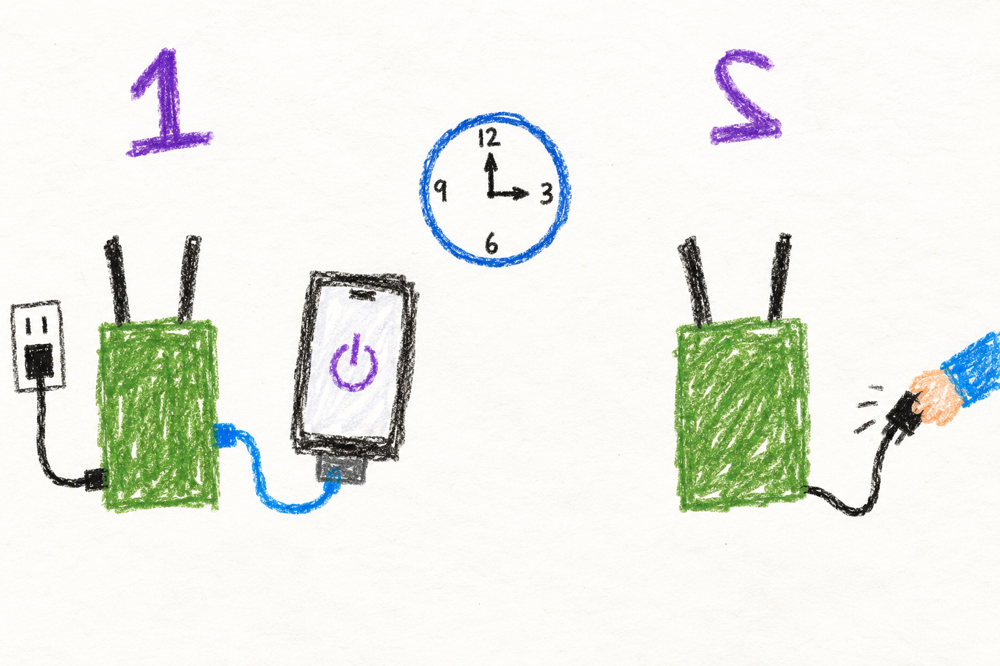

# Power, indicators and shutdown

## Marine

### Let it finish before pulling the plug

Your radio's volume knob is also a power switch.  Don't accidentally your radio
or you will not be able to talk to your friends until it is turned back on.

If your radio is just a cm4 on a bench, you can see the green heartbeat to know it is done
being set up.  Then you can unplug it.

## User

### Read the onboard LEDs

| Board indication | Meaning |
|---|---|
| Green heartbeat, red off | Provisioning completed. |
| Red heartbeat, green solid | Provisioning did not complete. |
| Still showing its boot pattern | Setup may still be running, or no verdict has been recorded. |

These are the supported board's onboard LEDs. They report the same setup
verdict as the SSH login banner. They do not count neighbors, confirm
internet service or prove that voice works.

An optional external LED/button harness has a different purpose. It is
disabled unless explicitly configured and wired. Pressing its button gives
one green blink per **direct neighboring radio**, not every radio reachable
through other nodes. Solid green for three seconds means connected but
still waiting for enough identity information to count; red means confirmed
zero; amber means the count could not be obtained. Multiple wireless links
to the same radio should count once.

### Check the power report

On supported boards, the dashboard and SSH banner report supply and
throttling information. A warning can record an earlier undervoltage event
even if power looks normal now. A board without the required reporting
interface has unavailable information, not an implicit healthy result.

The CM4 also has a deliberate CPU speed ceiling to reduce heat in a sealed
enclosure. A lower configured maximum speed alone is not evidence of a new
thermal fault; the live power/throttling report answers that question.

Unexpected resets, missing USB radios or failed associations can come from
power supply or cable problems under load. Record the indication before
rebooting, since reboot clears the board's event history.

### Shut down through the operating system

The current guide's shutdown method is an SSH login to the radio followed
by **`sudo poweroff`**. Use the SSH account and its configured password or
authorized key; this is separate from the web admin login. Ask the person
who manages the unit to do this if you do not use SSH.

Wait for the operating system to halt before removing power. Losing the
browser or SSH connection alone is not confirmation that storage writes
have finished. The external neighbor-count button is not a documented
power button. Normal shutdown gives the radio an opportunity to announce
its departure and finish writes; abrupt power loss cannot do that.

## Developer

### Provisioning state and connectivity are separate producers

The onboard LED service consumes the provisioning verdict, including the
legacy completion-marker fallback. It changes when setup finishes and on
subsequent boots. It is not a peer watchdog. The optional external harness
instead uses a bounded BATMAN `neighbors_json` query for direct neighbors.
Registry radio aliases collapse multiple links to one canonical node; the
registry itself cannot create a live neighbor.

Zero or one neighbor address needs no alias metadata. Multiple unresolved
or ambiguous aliases yield connected-without-an-exact-count. Query failure
is distinct from confirmed zero. Those distinctions drive green/red/amber
output and prevent unavailable metadata from manufacturing isolation.

The harness requires explicit `/etc/default/manet-led` configuration and
libgpiod v2. A shared lock gives a button display exclusive ownership while
boot blinks yield between half-cycles. Holder failure or termination releases
GPIO ownership. The electrical state after release depends on the circuit;
provisional pin assignments and software tests are not verified wiring.
See [external harness behavior](../../../docs/node-tools-internals.md#external-harness-audit).

### Departures withdraw service eligibility

The generated shutdown unit runs before shutdown/reboot/halt targets with
a ten-second start budget. It encodes a telemetry tombstone with
`NODE_STATE=SHUTTING_DOWN`, sends it three times at two-second intervals,
then allows three more seconds for propagation. The helper returns and
systemd continues shutdown; invoking the helper alone is not `poweroff`.

Peers retain identity but exclude the shutting-down state from relevant
elections. A tombstone is best-effort distributed information, not an
acknowledged transfer of every service session. Sudden power loss instead
relies on reachability and freshness expiry. Neither path guarantees that
a client avoids reconnecting after a host leaves.

### Hardware events and identity recovery

The CPU policy keeps cores online and prefers a demand-based scaling governor
(`schedutil`, then `ondemand` when available). On the CM4 it caps the maximum
at 800 MHz, bounded by the hardware's minimum and supported frequency steps;
other boards retain their reported hardware maximum. This configured ceiling
is distinct from live throttling caused by temperature or supply problems.

The power helper reads Broadcom live and sticky throttling bits when
available. Sticky undervoltage, capping or thermal events describe this
boot's history. Sampling a healthy current value cannot erase that earlier
evidence. The helper's failure-tolerant output must not break the dashboard
or login banner on other platforms.

A cloned provisioned card booted on different hardware is detected through
the saved primary MAC. The identity helper regenerates machine/SSH host
identity, discards saved IPv4 allocation and observation state, and derives
a new hostname suffix. A first boot with no saved MAC records identity
without resetting keys. A changed SSH host key after cloning can therefore
be expected, but should be verified against the physical node before a
client accepts it.

The separate SSH recovery helper restores the `radio` account and group
membership, configured radio password, SSH authentication settings, missing
host keys and service availability. It does not bypass the need for a
working network path. See [identity and recovery tools](../../node-tools-map.md#power-indicators-and-recovery).
