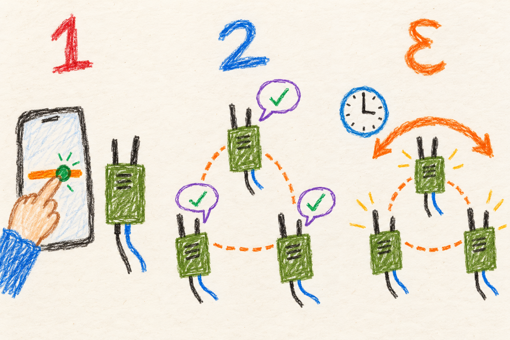

# Radio controls

## Marine

### Agree before changing the channel

Radios need matching settings to hear each other. Usually they choose their
Wi-Fi channels together.

Manually changing a channel or turning a radio off can break a path. Read the result
on the screen before changing something else.

## User

### Know which radio link you are changing

One MANET unit can contain several wireless interfaces. Conventional
2.4 GHz Wi-Fi, 5 GHz Wi-Fi and HaLow provide different links between nodes.
The local access point serves your phone and has a separate role. The
dashboard shows the detected interfaces. Absent hardware cannot provide
another path simply because a setting exists for it.

Open **Manage → Radio config** to inspect supported controls, including
interface state, channel and transmit power. Changes involving peers use
the shared acknowledgement/apply process. Turning off your only working
link can disconnect the nodes you are trying to configure.

### Automatic and manual channels

With automatic channel selection (ACS) enabled, the mesh coordinates its
conventional Wi-Fi channel decisions. Manual Wi-Fi channel changes are
rejected while ACS owns that decision. The mesh only moves when its channel
has lasting interference or another channel stays better for several rounds,
as described in [choosing channels](mesh.md#user-choosing-channels). The
[mesh guide](mesh.md) explains discovery, channel agreement, partition
healing and limp mode.

With ACS disabled, a manual Wi-Fi plan is saved by band and reapplied across
radio restarts. That does not remove the need for compatible settings on
the other nodes. A change may temporarily interrupt your management access.
Reconnect and inspect the result before assuming it failed.

HaLow offers the widths and channels supported by the selected region and
the current software. The current US plan reaches 8 MHz. The EU plan exposes
1 MHz. New US nodes start on channel 10 at 907 MHz with 2 MHz width. New EU
nodes start on channel 1 at 863.5 MHz with 1 MHz width. Use the region and
available choices configured for your deployment.

### What the power number means

The displayed transmit power is the driver's report, not a measurement of
the radio signal leaving the antenna. Firmware or hardware can limit it
below the requested setting. The mesh startup policy requests 30 dBm.
The client access point uses 5 dBm.

Wi-Fi power changes in the UI are temporary: a radio restart or reboot
returns to the startup policy. A requested reduction that does not take
effect is reported as a failure. HaLow power is displayed but cannot be
changed in the UI because its driver applies it at startup and reloading
the USB driver can fail.

For comparisons, record the actual displayed settings alongside a
[measurement](measurements.md). More requested power does not by itself
establish a better end-to-end link.

## Developer

### Authority is split by kind of setting

Mesh configuration transactions and immediate radio-state transactions use
related authenticated Alfred transports but distinct payloads. Configuration
uses types 70/73. Radio state uses 71/72. The receiver validates and stages a
package, acknowledges it, and applies an authorized action at its activation
time. The shared admin password authorizes control. An observed identity or
BATMAN peer does not. See [transaction lifecycle](settings.md#developer-transaction-authority-and-lifecycle).

ACS owns conventional Wi-Fi channel choice while enabled. Both API and
receiver/apply paths reject manual channel requests in that mode, so a client
cannot bypass ownership simply by skipping the UI. In static mode the plan
is stored in `/etc/manet/static-channels.json` and keyed by band. Receivers
resolve band `2.4` or `5` through their own role files. Saving a missing band
does not restart an unrelated interface.

### A channel change is a serialized state transition

Plan writes, active and lobby supplicant configurations, and radio restart
share the channel lock. A manual apply waits at most ten seconds. Failure
restores the prior plan and configurations. Static enforcement also reads
under the lock, skips a busy pass, and leaves radios alone if the plan is
malformed. This prevents the periodic manager from treating a half-written
plan as a completed operator decision.

ACS additionally coordinates membership, proposals, voting, activation and
recovery over all surviving mesh paths. HaLow connectivity can keep two
otherwise separated Wi-Fi groups in the same decision domain. The
[mesh mechanism](mesh.md#developer-one-connected-component-one-channel-decision)
explains that protocol and the limits of timed activation.

### PHY ownership and driver readback

Transmit-power control acts on a physical radio (PHY), not merely an
interface name. A Wi-Fi request is refused if the PHY cannot be identified
or another UP interface shares it. Otherwise a supposedly local change could
silently alter another role on the same device. After applying, the controller
reads back the driver's value and checks that a requested reduction took.

The ephemeral UI value is not a persistent boot policy. The boot mesh-power
service again requests 30 dBm, with driver/firmware limits determining the
reported result. HaLow's startup-only handling and unsafe USB reload path
explain why its power control remains read-only. The
[radio-control reference](../../../MANET/node_tools/README.md#web-interface)
records the current firmware reports and regional options.

### Recovery is layered below the dashboard

BATMAN interface setup and the enslave watchdog maintain mesh membership
when interfaces return. The SAE watchdog targets guarded authentication
recovery. USB Wi-Fi/HaLow recovery handles device appearance/disappearance.
An interface's administrative UP state, an authenticated station and an
originator route are different stages. Diagnostics should establish which
stage failed before forcing a restart. Consult
[network management](../../../MANET/node_tools/README.md#network-management)
and [hardware bring-up](hardware.md) for the lower layers.
