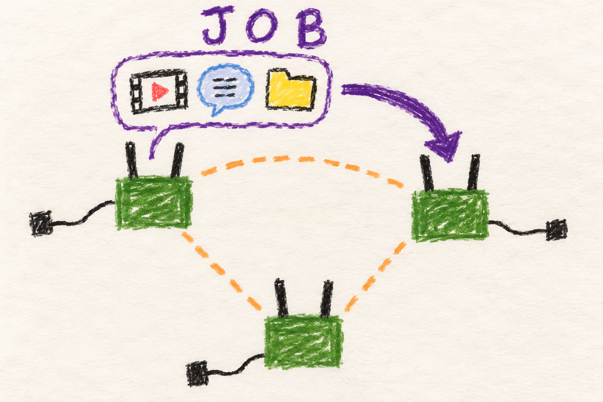

# Shared services

## Marine

### One radio takes a job

A radio can run little jobs, like a shared video stream or chats with the boys. If all the radios
chooses another radio for this job, that radio takes over and the job continues.

You may need to reconnect when the job moves or you move to far away from your friends.

## User

### What is available

| Service | What it does | What you provide |
|---|---|---|
| MediaMTX | Hosts media streams on an elected radio. | A compatible stream source and viewing application, with their stream settings. |
| Mumble | Hosts a Mumble voice server on an elected radio. | A Mumble client and the relevant account/channel settings. |
| Syncthing | Synchronizes configured files between peers, including the shared Mumble database. | Any additional folder configuration beyond the project defaults. |
| Time service | Shares a qualified clock source. | GPS or internet at a suitable node; see [time](time.md). |

The [physical PTT voice system](voice.md) is a separate service from Mumble.
Installing a Mumble client is not required to use the radio's headset/PTT.
Likewise, a MediaMTX server does not create a camera feed on its own.

### Find the current host and address

Expand nodes on the [dashboard](dashboard.md) to see which services they
advertise. MediaMTX and Mumble use reserved service addresses, so clients
can keep the same destination when another radio takes over. The host
radio's own mesh address and the shared service address have different jobs.

With the example mesh range `10.30.0.0/24`, MediaMTX uses `10.30.0.2` and
Mumble uses `10.30.0.3`. Use the addresses derived from your actual configured
range. A MediaMTX RTSP client also needs the stream's path. Knowing the server
address does not tell it which stream to play.

### What happens when radios move or leave

Radios compare their reported mesh connections to choose a host. The current
host gets a preference so small fluctuations do not constantly move a
service. A shutting-down or unheard node is excluded. When the host changes,
the old host keeps the service running until the new one has it up, so the
gap is short.

Enable each service on every radio. A radio with the service turned off can
still be chosen as host, and then the current host keeps serving and waits for
it indefinitely. The flasher's MediaMTX default is off, so this is easy to hit.

If the mesh splits, each disconnected group may run its own host. When the
groups meet again, they settle on a winner. A stable service address helps
applications reconnect, but it does not transfer a live video or voice
session without interruption.

Mumble's saved accounts and channels are copied through the shared folder
when hosts change. Changes made in the last few seconds before a hand-over
can land in the old host's retired copy instead of on the new host. A sudden
power loss or unsynchronized partition can still leave the newest changes
unavailable. Keep a separate backup of
important configuration. Syncthing is a file synchronization mechanism.
Deletions and unwanted changes can synchronize too.

## Developer

### Ranking and stable ownership

MediaMTX and Mumble use the same deterministic election helper. Candidates
must have a valid MAC, finite nonnegative `MEAN_THROUGHPUT_MBPS`, a state
other than SHUTTING_DOWN/STALE, and an observation no more than 300 seconds
old in the receiver's boot-clock domain. Invalid or future observation
times fail eligibility. An unreadable registry is distinct from an empty
eligible set.

The metric is the mean of the best BATMAN throughput path per originator,
so two interfaces to one originator do not create two samples. Among eligible
advertised incumbents, the greatest raw metric wins incumbent status, with
lowest MAC breaking ties. That one incumbent receives a 10 Mbit/s scoring
bonus. The greatest resulting score wins, again with lowest MAC on ties.
For example, a host with metric 20 scores 30. A challenger at 29 does not
displace it. A challenger at 31 does.

Elections wait for address allocation and run at most once per fifteen
seconds of boot uptime. A settled pass is answered by the resident runtime
without starting any process. Each service serializes local transitions. This
prevents overlapping local starts/stops, but cannot impose global mutual
exclusion across disconnected partitions. Rejoining and fresh registry
exchange cause losing hosts to release ownership.

A host that loses the ranking keeps serving until the winner has claimed both
addresses. It releases on the winner's IPv4 ARP, its IPv6 neighbor
advertisement, a reply to its own probe, or the winner's fresh serving flag in
the registry. Each wait is bounded to 12 seconds per pass. On this mesh the
ARP normally never arrives, because BATMAN's distributed ARP table absorbs it,
so the IPv6 advertisement usually ends the overlap in well under a second.

Every radio must have the service enabled. A radio with `mtx=n` or `mumble=n`
can still win the ranking. The current host then keeps serving and waits
indefinitely, with one log line saying so.

### Virtual addresses and application lifecycle

MediaMTX claims the first usable IPv4 host plus one, and Mumble plus two:
`.2` and `.3` in the example `/24`. These lie in the range reserved ahead
of ordinary node allocations. IPv6 helpers derive stable service `/128`
addresses using the normalized mesh ULA prefix and service-specific suffix
logic. The winner starts the service first, checks that the unit is active
and its listeners are up, and only then claims both addresses and announces
them. If the start fails, it stops the unit and retries at the next pass, and
the old host keeps the service. On a CIDR change the old IPv4 service
addresses are retired. IPv6 service addresses do not depend on the CIDR.

MediaMTX listens on all addresses (RTSP 8554, WebRTC 8889) and Mumble on
64738 TCP and UDP. IPv6 clients work, and the listener already exists before
the service address moves. Client stream paths and publisher behavior belong
to the application's configuration.
Moving the listener address does not move a TCP socket, encoder or pending
media buffer. Documentation and applications must handle reconnection.

### Mumble state transfer and Syncthing

Before Mumble starts, its winner copies the database from the shared
Syncthing folder. The serving host exports its database whenever it changes,
at the 15-second election cadence. A host that loses stops Mumble after the
winner claims, then saves its final copy under `retired/<owner>/` in the
shared folder instead of over the shared file. The newest three copies per
owner are kept, none older than 30 days. Integrity checks and backups guard
those local transfers. Syncthing peer management discovers
device IDs through the registry, adds peers to the configured share, and
restarts only when its configuration changes.

Database synchronization and host election are different consistency
mechanisms. A shared filename is not a transactional multi-writer database.
Changes made in the last export interval before a hand-over are not on the new
host, but they are in the old host's retired copy and can be restored by hand.
An abrupt loss can prevent the departing host's final copy. Concurrent
partition hosts can diverge. The implementation does not guarantee lossless
application state or continuous sessions across that case.

Time servers use their own source qualification and client selection, not
this MediaMTX/Mumble scoring helper. See [time ownership](time.md) and the
[service-election reference](../../../docs/node-tools-internals.md#service-elections).
