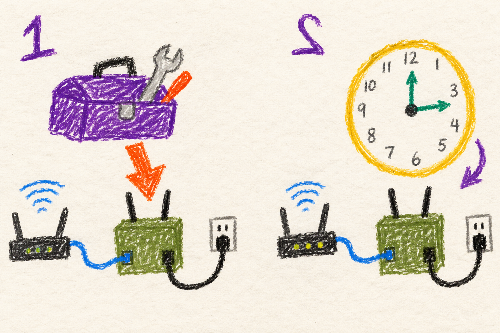

# Storage, logs and saved state

## Marine

### Keep the things you need

The radio saves settings and test results. Its storage is big but can fill up.

Download test results you want to keep. Then delete old sessions you no
longer need. If something broke, save its logs before they roll away.

## User

### What the radio remembers

Settings and saved measurement sessions survive a reboot. Some temporary
information does not: the radio rebuilds its current view of neighbors,
checks time again and requires a new web login. These are different kinds
of state, so an empty or changing display after startup does not necessarily
mean saved settings were lost.

Measurements remain on the radio where they ran. **Manage → Sessions** lets
you export JSON or CSV and delete unneeded sessions. They are not silently
copied to every other radio or automatically removed to make room.

### What happens when space runs low

The measurement store has a bounded budget: by default 256 MiB, at most
4,096 files and 128 sessions, with space also reserved for the system. A
full budget stops new measurement work with an error. Download and remove
unneeded sessions, then try again. A system-wide storage problem can affect
other services too; this budget does not limit every file on the radio.

Diagnostic logs are rotated: older copies are eventually replaced. Preserve
relevant logs promptly when reporting a problem, along with the node name,
version, approximate time and what you were doing. The
[troubleshooting guide](troubleshooting.md) identifies useful evidence.

### Updates and backups

An [update](updates.md) has staging and recovery state so an interrupted
installation can be recognized. Those files are part of recovery; do not
delete unknown files just because an update stopped midway. The recovery
path has limits and is not a backup of everything you put on the radio.

Keep separate copies of important exported measurements, custom setup
scripts and configuration you would need to recreate. Shared files can be
synchronized by Syncthing, but synchronization also propagates changes;
it does not replace a separate backup.

## Developer

### Persistence follows the purpose of the state

| State | Location or owner | Lifetime and use |
|---|---|---|
| Mesh configuration | `/etc/mesh.conf` | Persistent policy, with local and shared keys governed by config transactions. |
| Remembered IPv4 block | `/etc/mesh_ipv4_state` | Persistent preference; current peer claims can force reallocation. |
| Registry observations and claims | `/run/manet-registry/` | Rebuilt this boot; freshness uses local boot time. |
| Initial clock qualification and refresh state | `/run/initial_time_synced`, `/run/mesh-time-client.json` | Survive controller restart, not reboot. |
| Web login sessions | Web-process memory | Lost on service restart/reboot or password change. |
| Measurements | `/var/log/manet-measurements/` | Persistent exports/results, explicitly removed by the operator. |
| ATAK retained phone/manual state | `/var/lib/manet-atak/` | Durable state with age/freshness handling, not a live service heartbeat. |
| Operator-script completion | `/var/lib/manet-user-scripts.state` and `.done` | Prevents repeating completed hooks; separate from provisioning verdict. |

Replay protection and update transactions also retain durable state because
a process restart must not make an old command new or erase evidence of a
partly installed payload. Use [settings](settings.md) and
[updates](updates.md) for their lifecycle; copying a live state directory
without understanding its ownership is not a migration strategy.

### Measurement admission is a budget, not pruning

The storage helper accounts for allocated/logical bytes, regular-file count,
session count, per-result size and filesystem free space. Defaults are
256 MiB total, 4,096 files, 128 sessions, 1 MiB per result and 128 MiB free
space. Admission reserves room for one maximum-sized result, then checks
again before each test and each durable atomic save. Temporary output also
uses space, so a result cannot be accepted on final JSON length alone.

No automatic pruning occurs. Exhaustion goes through the normal measurement
error path while existing sessions remain available for export. Limits can
be overridden through `MANET_MEASUREMENTS_MAX_BYTES`, `MAX_FILES`,
`MAX_SESSIONS`, `MAX_RESULT_BYTES` and `MIN_FREE_BYTES`, each with the same
`MANET_MEASUREMENTS_` prefix. Put overrides in the web service's systemd
environment drop-in rather than editing packaged files. These are MANET
measurement limits, not a filesystem quota for Syncthing or other programs.

### Log retention trades history against writes and storage

The dedicated logrotate timer first runs five minutes after boot and then
every fifteen minutes. Its explicit MANET log list uses a 5 MiB threshold,
three archives and delayed compression. The threshold is checked on that
schedule, so it is not a strict maximum file size. `copytruncate` keeps an
existing append descriptor usable but can lose lines during copying.
The journal has its separate persistent policy; application-owned logs and
synchronized files are outside this standalone-log list.

For a custom log list, configure `MANET_LOGROTATE_CONFIG` to a root-owned
file outside the packaged path. Do not edit generated archives or expect
tools updates to preserve a modification to the packaged default.
See [bounded logs and measurements](../../../docs/node-tools-internals.md#bounded-logs-and-measurements).

### Base-system cleanup is a provisioning operation

The cleanup profile removes selected stock-image packages, services, swap
and caches while protecting required runtime dependencies. Its recorded
profile state prevents later setup from repeatedly removing software the
operator installed afterward. It runs during initial setup before operator
scripts; ordinary tools updates do not silently reapply it. The
[cleanup implementation](../../../MANET/node_tools/manet-os-cleanup.py)
provides the plan/apply boundary and protected dependency checks.
