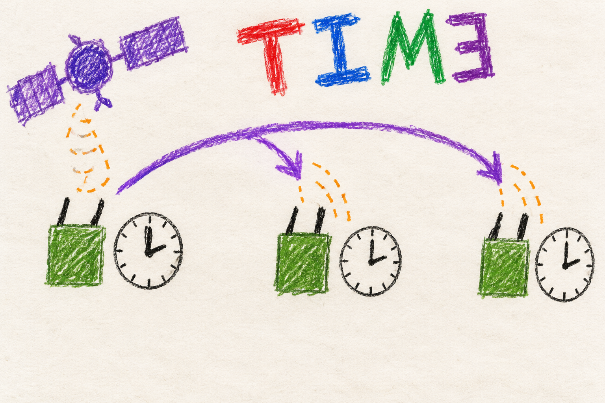

# Time and GPS clocks

## Marine

### Get the clocks to agree

A radio can learn the time from GPS or the internet. Other radios can ask
it for the time.

The radios need matching clocks to do some jobs together. With no GPS or
internet, they wait about three minutes and then all use one radio's clock.
It may be wrong, but it is the same on every radio. Give one radio GPS or
internet if you need the right time.

When two groups of radios meet, the smaller group takes the bigger group's
time.

Knowing the time does not tell a radio where it is.

## User

### Why time matters

The radios schedule some changes for a shared moment, including coordinated
channel and configuration changes. If their clocks disagree, one could
change too early or reject another's message. MANET therefore verifies a
time source before enabling timed control.

A GPS receiver with a usable fix can supply time. A radio with its own
internet uplink can obtain time from public time servers. Other radios get
time from radios they can reach. They do not all need separate internet
connections. A radio that had GPS or internet time earlier is preferred over
one that only learned the time from other radios.

### What to look for

The dashboard's **Mesh recovery** details show the last verified clock
source and whether time is ready. GPS details show whether a receiver has
a position fix. A receiver being plugged in is not the same as a usable
fix, and a gateway advertisement is not proof that a time check succeeded.

At startup, a radio asks the radios around it for the time. One that had
GPS or internet time answers within a minute or so. If no radio in reach has
a clock it trusts, they wait about three minutes, then all follow one radio's
clock. Timed control starts working, but that clock can be off from real time
by however far that radio was off.

A radio sets its clock in one jump at its first sync after startup, and
when its group meets a bigger one. When two groups of radios meet, the
smaller group jumps to the bigger group's time. A group with GPS or internet
time always wins, and equal groups keep the time of the group with the lowest
radio address. Otherwise radios correct gradually. If GPS or internet appears
on a radio already in the group, the others move toward it slowly, less than
a minute a day. Reboot a radio to make it take the right time at once.

A clock jump cancels settings changes that were sent but not yet applied, and
restarts any channel vote in progress. Send the change again.

After an initial successful check, losing the source does not stop the mesh.
The radio continues on its own clock. It checks again when another radio
joins, when a GPS or internet source appears, and once a day.

### Time is separate from location

A radio can learn time from a neighbor without learning its own position.
The ATAK integration has separate rules for location and phone-provided
information. It does not set the radio's system clock from a phone.
See [location and ATAK](location.md).

## Developer

### One controller owns chrony

The time controller, launched by `one-shot-time-sync.service`, is the sole
runtime owner of chrony's configuration and lifecycle. Local source roles
are checked every fifteen seconds. This ownership prevents a finishing mesh
client attempt or a departing uplink handler from stopping a newly available
GPS time source.

A recent GPS fix enables the SHM refclock. A direct uplink enables configured
internet servers with Network Time Security (NTS), with acquisition bound
to the uplink interface. Ordinary mesh nodes never receive unconditional
internet sources. Only qualified GPS and NTS sources set `is_ntp_server` in
telemetry. Mesh time between other nodes uses chrony's orphan mode, below.

Qualification checks chrony command success, a real reference, stratum 1–15,
synchronized leap state, at most 0.1 seconds remaining system-clock
correction, and a recent selected source with nonzero reach. Internet
qualification also requires negotiated NTS authentication. The 0.1-second
condition measures remaining correction, **not absolute UTC accuracy**.

### Peer selection uses evidence independent of the clock being repaired

The controller joins registry identities to BATMAN radio aliases, accepts
only unambiguous IPv4 host addresses inside the mesh CIDR, and requires a
selected route with positive throughput and last-seen age no greater than
thirty seconds. It lists up to eight peers, advertised real sources first,
then by throughput, excluding self and shutting-down nodes.

Peer wall-clock timestamps cannot establish bootstrap freshness when the
local wall clock is wrong. Live kernel route age and an actual NTP sample
from a listed peer provide the relevant evidence.

### Mesh time on demand

Between windows chronyd is stopped. `chrony.socket` holds UDP 123, so a
peer's request starts chronyd with the sockets already bound. `chrony.service`
does not start at boot, and the socket is armed only after the controller
writes this boot's profile, so a rebooted node never serves a stale clock
from the previous boot's profile. Windows open
at boot, when a peer arrives or returns after ten minutes away, when a real
source is newly advertised, once a day, and when a request wakes chronyd.
The first window of a boot lasts twenty minutes so chrony learns the
crystal's drift. Later windows close after a sync from that window, or at
three minutes.

Each window profile polls the listed peers. A node with a clock also runs
`local stratum N orphan`: stratum 8 after GPS or internet time earlier this
boot, stratum 10 after mesh time only. A node that never synced serves
nothing for three minutes, then uses stratum 12. chrony prefers the lowest
stratum and, among equal strata, the lowest address, so every node agrees on
one reference. A node whose own reference stays selected for sixty seconds
records `mesh` as its source.

### Initial synchronization, refresh, and holdover

Successful initial synchronization creates `/run/initial_time_synced`.
The next refresh is due after twenty-four hours plus a per-boot stagger of
zero to ten minutes. Source nodes keep chrony running. Local role checks can
promote a node when GPS or an uplink appears.

Initial acquisition may step the clock. After the first verified success,
the controller disarms startup stepping and subsequent corrections slew,
except when the node's group merges into another.

### Merging groups and clock jumps

Peers that arrived since a node's last sync form the other group. Every node
ranks the two groups the same way. A group with an advertised real source, or
a node synced from one earlier this boot, wins. Next comes the larger group,
then the group holding the lowest MAC. A node on the losing side opens a `merge`
window that polls only the arrivals, permits a step, and serves no clock until
it follows them.

`manet_clock.py` tracks the wall clock's offset from `CLOCK_BOOTTIME`. A change
of more than ten seconds starts a new clock epoch, whatever caused it. Admin
control channels then void every authenticated command present in Alfred,
including ones the new clock places in the future, and restart ordering at
the jump, the sender drops its own history, staged config and
radio changes are cancelled, and ACS agreement drops its rounds while keeping
its boot-clock timers. Activated changes continue, because their rollback
deadlines use the boot clock.

Failure after initial success retains the boot-ready marker but withdraws
source-serving flags and keeps retrying. A marker is evidence of a past
success, not current accuracy. `/run` state disappears on reboot. Missing
refresh state cannot grant another day's delay merely because the marker
exists. The [time reference](../../../docs/node-tools-internals.md#time-synchronization)
describes remaining drift. The
[mesh guide](mesh.md#developer-one-connected-component-one-channel-decision)
explains why scheduled channel activation depends on these clocks.
