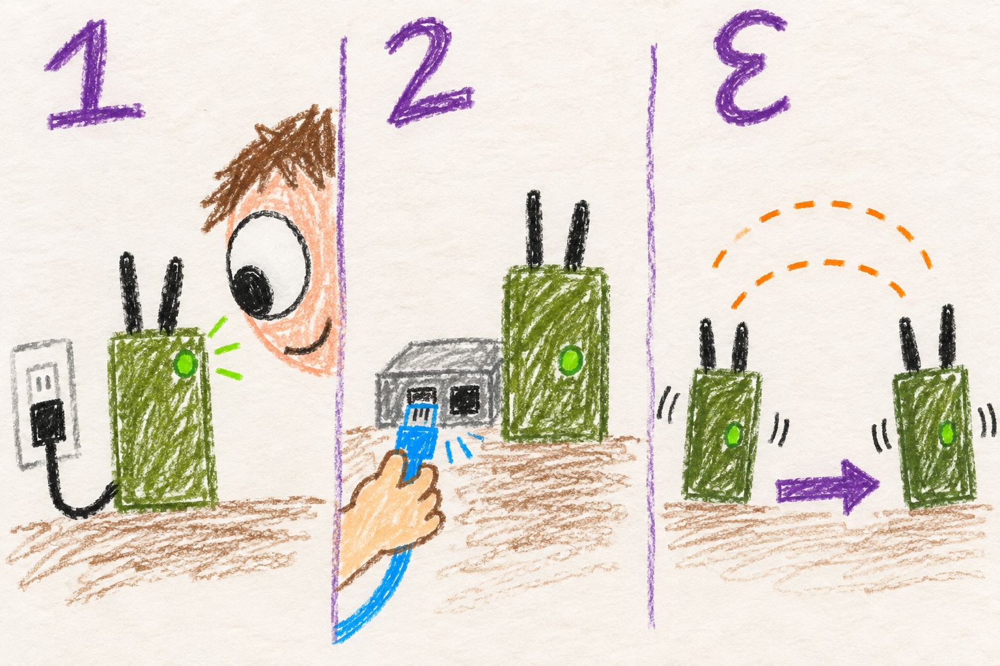

# When something is wrong

## Marine



### Power. Cable. Other radio.

1. **Power:** is the radio powered, and did setup finish?
2. **Your connection:** check the cable or join this radio's Wi-Fi.
3. **Other radios:** are they on? Try moving closer.
4. **Look:** open [status](http://manet.local/) and check what is missing.

On a CM4, **red heartbeat with green solid** means setup did not finish. Reconnect internet Ethernet and reboot to retry.

Still stuck? Save the error message and which radio has the problem.

## User

### Start with what stopped working

Check power, cables, and whether this radio completed setup. Then separate your phone's connection from the radio's mesh connections: a reachable dashboard with no peers is a different problem from a phone that cannot open the dashboard at all.

| What you see | What to check next |
|---|---|
| Setup keeps rebooting or never finishes | Leave power and internet Ethernet connected. First setup takes about ten minutes and several reboots. Check the [first-boot guide](first-boot.md). |
| CM4 green heartbeat, red off | Provisioning completed. Open status to check actual mesh connections. |
| CM4 red heartbeat, green solid | Provisioning is incomplete. Restore internet Ethernet, reboot, and let setup retry. |
| `manet.local` will not open | Connect to this radio's Ethernet client port or enabled AP. Try its local IP address if name resolution fails. The upstream LAN and other radios' clients are outside its dashboard access boundary. |
| Status opens, but Manage needs a password | Use the admin password chosen during flashing. An expired session or a service restart requires a fresh login. |
| No peers, or fewer peers than expected | Check that the other radios are powered, within usable range, and configured for the same mesh. Inspect **Mesh recovery** before changing channels. |
| Settings are waiting for time | Let a verified GPS or network time source become available. Shared timed changes wait for the first synchronization. |
| No voice audio | Check voice enablement, audio hardware, the Voice tab, and matching talk group and codec. See [push to talk](voice.md). |
| An update failed | Record the message and inspect updater logs. Use [update recovery](updates.md) for an interrupted installation. |

### Missing Wi-Fi does not always mean a broken mesh

A radio can retain a path through HaLow when conventional Wi-Fi is out of range. Check actual reachable peers rather than only whether an interface says it is ready. With ACS enabled, radios may be waiting for time, acknowledgements, a recovery window, or a usable radio path.

If the phone's Wi-Fi network disappears, check the configured EUD mode. In Auto mode a wired client takes priority, and with ACS enabled the AP also depends on gateway state. [Connection modes](connect.md) explains that behavior.

After a protected configuration change, previously connected radios can restore their old settings if no peer returns within the default five-minute trial. Check the outcome before staging another change; do not assume that all radios kept the requested values.

### Rule out a power problem

Low power can look like a radio fault: failed association, a USB device that stops answering, or unexpected resets. On supported Raspberry Pi hardware, inspect the dashboard's power state or the SSH login banner. A warning can record a voltage drop that happened earlier in this boot.

Rock 3A does not provide that same Broadcom power readout. An unavailable measurement does not prove that its power supply is healthy.

### Record enough to reproduce it

Before rebooting an already provisioned radio, note its hostname and version, the time of the problem, how your phone was connected, the peers you expected, and the exact error or screenshot. Note any setting or update made immediately beforehand. A reboot clears some recovery observations.

If SSH is available, these commands read status and recent messages:

```bash
hostname
cat /etc/manet_version.txt
manet-provision-status.sh
manet-power-status.sh
sudo systemctl --failed --no-pager
sudo journalctl -u mesh-status.service -u node-manager.service -n 100 --no-pager
```

For an update problem, also collect `sudo journalctl -t manet-update -n 60 --no-pager`. Share the relevant output, not a copy of `/etc/mesh.conf`, which contains credentials.

## Developer

### Diagnose the failing layer

| Layer | Useful evidence |
|---|---|
| Provisioning and power | `manet-provision-status.sh`, `manet-power-status.sh`, failed systemd units, and setup logs. A completed setup verdict does not prove a peer link. |
| Local client access | EUD mode, Ethernet role, DHCP allocation, bridge state, and `manet-ui-firewall.sh` policy. Preserve the local-client boundary while diagnosing access. |
| Actual mesh reachability | Live `batctl meshif bat0 originators_json` and neighbor state, alongside the registry. Deduplicate originators; a failed query is not zero peers. |
| Channel recovery | `/run/manet-acs-status.json`, `/run/manet-rendezvous.json`, `/run/manet-last-channel-change.json`, and the dashboard's **Mesh recovery** panel. |
| Timed control | Initial-sync marker, verified time source, authenticated ACK state, and replay/apply results. Check clock readiness before assuming a transport fault. |
| Voice and updates | Voice health and codec agreement; updater journal and pending recovery state. Use the corresponding topic for interpretation. |

The public `/api/debug` route exposes raw BATMAN observations and identity mapping within the same local-client access boundary. Registry presence can outlast a usable link; a ready HaLow interface is also distinct from a reachable originator. Compare evidence from the same time window.

### Preserve the evidence needed for recovery

`/run` observations disappear at reboot. Administrative replay records and configuration rollback snapshots persist because receiver restarts and reboots must not authorize old commands or lose a pending restore. Do not clear these directories as a routine troubleshooting step.

For updater failures, retain `/var/lib/manet-update/in-progress` and its recovery archive. `--recover-only` retries the verified pending payload before any new release selection. Missing or corrupt data is a repair case, not permission to mark the installation complete.

Check installed service units and their actual running processes when an observation disagrees with the source. `node-manager.sh` is a generated selector symlink; the active ACS or static orchestrator and installed package version matter. Reproducing a software state in a unit test does not establish physical radio behavior.

- [Provisioning and power status](../../../MANET/node_tools/README.md#setup--provisioning)
- [Recovery and channel mechanisms](mesh.md)
- [Web access and diagnostic routes](../../../MANET/node_tools/README.md#web-interface)
- [Rollback internals](../../../docs/node-tools-internals.md#mesh-configuration-push)
- [Update recovery](updates.md)
