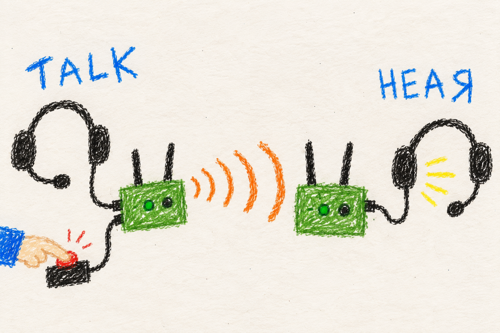

# Push to talk

## Marine

### Same group. Press. Talk.

1. **Voice enabled.** Use a supported audio/PTT setup plugged into the radio.
2. **Same talk group.** Everyone who needs to hear you chooses that group.
3. **Hold the button.** Speak into the headset microphone.
4. **Release.** Your microphone stops transmitting.

You can hear other speakers while your button is released. Speaking louder does not make the signal go farther.

Audio level controls are in the Voice tab — if too quiet or too loud, adjust there.

## User

### Voice comes from the radio's headset

Mesh PTT uses an audio device and physical push-to-talk button attached to the radio. Enable mesh voice during setup. The web interface shows status and lets you choose a talk group. It is not a browser microphone.

The supported USB path uses a CM108-family audio device and is intended for OpenVLM hardware. Headset wiring and microphone level matter: a military dynamic microphone needs suitable amplification before the CM108B input. Check the [audio hardware reference](../../../MANET/node_tools/README.md#audio-hardware) before connecting a headset. An electret mic needs no amplification on a bare OpenVLM.

### Select the same talk group

Open the management UI's Voice tab. Radios start on group 1 and can select groups 1 through 32. Set each participating radio to the group you want. Changing your radio's group does not move anybody else.

Hold the physical PTT button to transmit. Release it to stop transmitting. Receivers can mix simultaneous speakers, so two people talking at once are both heard.

### When there is no audio

Confirm voice is enabled, the mesh is connected, the talk groups match, and the Voice tab reports a healthy audio path. Then check the audio hardware and microphone wiring.

The default codec is **Lyra**. It transfers good-quality audio with less bandwidth than Opus, but lacks compatibility with other tools that would expect Opus. Lyra and Opus do not interoperate. A radio that missed a mesh-wide codec change while powered off must be set to the same codec. Reissue the change with it online.

A receiver remembers at most 128 talkers, and each radio can add only a few new ones in a short time. If one radio's voice service restarts many times in quick succession, other radios may refuse its new voice for a while, until its old entries expire after about 15 minutes without traffic.

### GAIN card controls

The Voice tab's GAIN card has live audio controls:

- **RX gain slider** — per-talker receive gain, 0 to 24 dB. Adjust individual talkers who are too quiet or too loud.
- **Playback slider** — overall mixer output level, 0 to 100%. Sets how loud the mixed audio plays back.
- **Input meter** — shows your microphone level in real time. Red means clipping; lower the mic gain or speak softer.
- **Controls apply live** — no restart needed. Sliders take effect immediately.

## Developer

### Pipeline and transport

`mesh-voice.py` owns GStreamer transmit and receive pipelines. The physical PTT controls the transmit valve. OpenVLM/CM108B input is read through USB HID, not an SBC GPIO. The web interface exposes status and configuration, not browser capture.

Voice defaults to Lyra using the packaged GStreamer elements and model weights. Missing Lyra artifacts can trigger an Opus fallback, which cannot communicate with a Lyra mesh. Treat codec and payload framing as compatibility requirements, not quality preferences.

Talk groups share multicast address `239.192.41.1`. Group *n* uses RTP port `38801 + (n - 1) * 2`. The next port is reserved for RTCP, but no RTCP is sent or received. Each packet passes source admission before it reaches the RTP session. The receive path demultiplexes SSRCs, gives talkers their own decode/jitter paths, and mixes them. Optional half-duplex behavior refuses local PTT while a remote source is transmitting.

The transmit path captures audio through ALSA, measures its level, gates it
with the PTT valve, encodes it, and places the encoded frames into RTP
packets. On receive, RTP identifies the sender's stream, a jitter buffer
reorders and schedules packets, and the matching decoder produces PCM audio
for the mixer. GStreamer handles the audio path. The Python daemon supervises
state and devices rather than processing each audio sample.

Each sender has its own RTP sequence numbers and timing. Feeding several
senders into one jitter buffer would mix unrelated sequence spaces and
discard or misorder valid packets. Separate receive branches preserve those
timelines, then the mixer combines their decoded audio. A permanent silent
input keeps the playback device running while nobody speaks, avoiding a
device startup at every PTT press.

### Establishing a speaker before speech starts

The RTP synchronization-source identifier, or SSRC, identifies one sender
instance. Each run picks a fully random 32-bit SSRC, and receivers name a
talker from its sender address, not from the SSRC. Reusing the same source
identity after a restart could pair new sequence numbers with a receiver's
old state. A fresh SSRC lets receivers establish the restarted stream
separately. Receivers admit at most 128 sources, with a small per-address
budget for new ones. An admitted source is released only when the RTP
session's inactivity timer removes it, about 15 minutes after its last packet.

Receivers keep established sources through silence so the next transmission
does not pay the full branch-creation cost. A sender also emits a short
muted presence transmission at startup and when newly observed peers need
to learn it. The beacon uses the sender's actual RTP sequence/timestamp
space, as a receiver inventing packets on another sender's behalf would create
the wrong state. These choices reduce clipped beginnings without continuous
audio transmission. The [voice internals](../../../docs/node-tools-internals.md#voice)
describe branch limits, cleanup, and the fallback beacon interval.

Local multicast loopback is disabled on the transmitting socket, and the
receive path also discards packets carrying its own SSRC. Otherwise a radio
could play its microphone back a jitter-buffer delay later and, in optional
half-duplex mode, mistake itself for a remote speaker.

### GAIN card implementation

- **Playback level fix** — the mixer output level is applied at daemon startup and reapplied on device replug so the playback volume persists across restarts and hotplug events.
- **Per-talker RX gain in F32LE with limiter** — each remote talker's receive branch has a named gain element operating in 32-bit float with a limiter to prevent clipping when multiple talkers sum.
- **Named gain elements update live** — when the RX gain slider moves, the corresponding named gain element is updated immediately without pipeline rebuild.
- **Input meter reads existing level element** — the microphone input meter uses the pipeline's existing level element; no extra probe or branch is added.

### Multicast, scheduling, and packet size

BATMAN's multicast optimization already fans out to unicast where applicable. Receivers must join the multicast group. Additional userspace unicast redundancy is off by default. Voice uses DSCP CS6 (48) to reach the desired queue through BATMAN's priority mapping.

Group membership is functional, not merely a receiver preference. BATMAN
can suppress a multicast transmission when it knows of no listeners. With
eligible listener counts, it forwards separate radio unicast frames to the
listeners, obtaining the underlying link's ACK/retry behavior. Adding another
application-level unicast copy would then spend airtime on the same audio
twice. That is why multicast reception and membership propagation should be
checked before interpreting silence as an encoder fault.

Lyra adapts frames per packet while keeping bitrate fixed. Under loss it reduces packet duration, subject to the low-throughput floor, to limit the speech lost with each packet. Buffer sizing and branch lifetime matter independently of codec speed. Do not describe estimated pipeline delay as measured mouth-to-ear latency.

### Configuration and failure handling

Talk-group changes are local: write `voice_channel` and reload through the checked retune path. Codec changes require mesh-wide staging and ACKs because encoder, payload, and clock rate change together. An offline node does not automatically reconcile a missed codec change.

Transmit remains blocked until the socket is bound to the configured voice interface and its IPv4 address. A held PTT resumes only when the binding and duplex conditions permit it. A watchdog monitors actual audio flow so a pipeline reporting PLAYING cannot hide a stalled USB path indefinitely. `/run/mesh-voice.json` supplies the status readout.

- [Voice settings and operational behavior](../../../MANET/node_tools/README.md#push-to-talk-voice)
- [Pipeline, multicast, buffering, and QoS internals](../../../docs/node-tools-internals.md#voice)
- [Voice daemon](../../../MANET/node_tools/mesh-voice.py)
